# LEOTherm 1.5 — User Manual (Windows standalone)

LEOTherm simulates the thermal behaviour of a low-Earth-orbit (LEO) satellite and of the GNSS
receiver it carries. It solves an 11-node lumped-parameter thermal network driven by orbital and
attitude histories, reports component temperatures and response metrics, and compares the result
against telemetry. The Windows package runs under the free **MATLAB Runtime R2021b**; MATLAB itself
and a MATLAB licence are **not** required.

A MATLAB licence is needed only if you run the simulator from source (`src/`).

This manual covers installation, the interface, the command line, the output files, the metric
definitions, and how to reproduce the results published with the software. The step-by-step
reproduction of the companion paper is in `reproduce_paper_v1.5.md`.

---

## 1. Install and start

1. Install **MATLAB Runtime R2021b** from the MathWorks MATLAB Runtime download page if it is not
   already present. The Runtime is free; no licence is required.
2. Extract the release archive (`LEOTherm_1.5_windows*.zip`) to a writable directory. Do not run it
   from inside the compressed archive.
3. Open `LEOTherm.exe`. The interface opens in English; the language selector also offers Chinese.

The **first** launch extracts and caches the Runtime component, so it takes noticeably longer than
later launches. Subsequent launches reuse that cache.

Version 1.5 defers the advanced pages until they are first opened. This changes **startup behaviour
only** — task parameters, the solver and all reported results are unchanged from the previous
release.

---

## 2. Interface overview

### Illustrated Walkthrough: Choose the Right Entry Point

These are real v1.5 UI captures. Orange outlines identify controls; blue numbers refer to the
instructions below each image. Open the offline HTML and click an image to inspect it at full size.
The documentation-only illustrated package uses the same tested executable as the release.

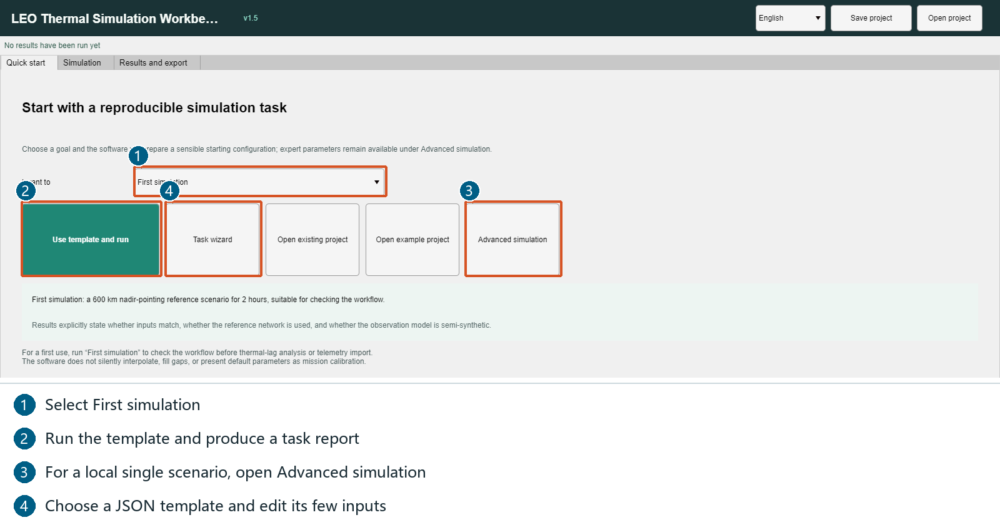

For a first report, select **First simulation** at ①, then click **Use template and run** at ②.
Choose a writable **parent folder**, such as `C:\LEOThermResults`, in the subsequent Windows folder
picker. The software creates a new task subdirectory. This shortcut runs a complete task and
produces a report; it is not the single-scenario local button. Save an edited project first, because
applying a template replaces unsaved scenario/network settings.

For a local calculation without automatic PDF generation, use **Advanced simulation** at ③, then
follow the single-scenario instructions below. **Task wizard** at ④ is the JSON-template entry point.
Use the separate [paper reproduction guide](reproduce_paper_v1.5.md) for the published 36-case study.

### Illustrated Walkthrough: One Scenario Only

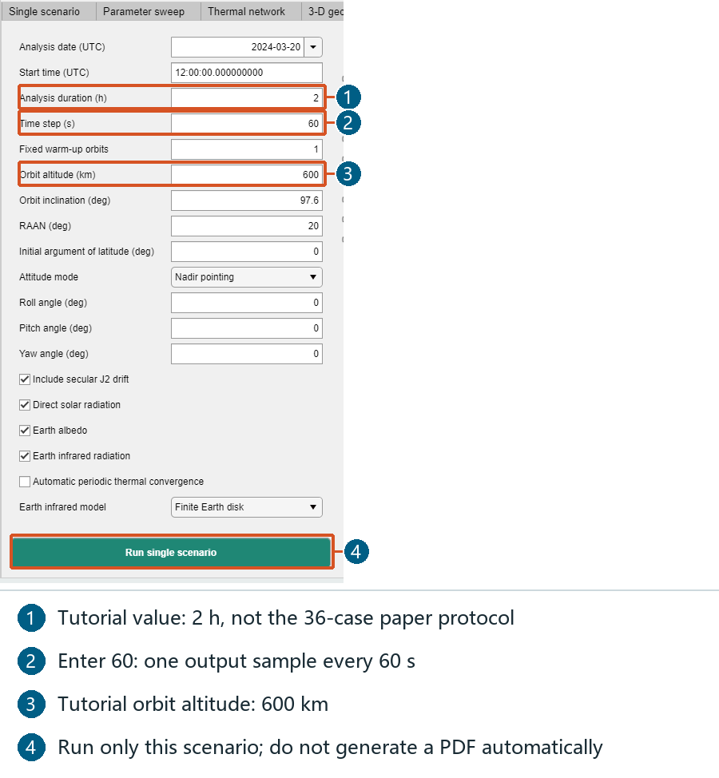

1. Open **Simulation > Single scenario**. Scroll the input area if needed; its local run button
   remains at the bottom of the sidebar.
2. For the illustrated tutorial, enter the values below. These are a quick practice configuration,
   **not** the 36-case paper protocol.

| Field | Tutorial value |
| --- | --- |
| Analysis date (UTC) / Start time (UTC) | `2024-03-20` / `12:00:00` |
| Analysis duration (h) / Time step (s) | `2` / `60` |
| Fixed warm-up orbits | `1` |
| Orbit altitude (km) / Orbit inclination (deg) | `600` / `97.6` |
| RAAN (deg) / Initial argument of latitude (deg) | `20` / `0` |
| Attitude mode / Roll, Pitch, Yaw | `Nadir pointing` / `0, 0, 0` |
| Automatic periodic thermal convergence | Unchecked |

3. Leave direct solar, albedo and Earth infrared enabled, with **Finite Earth disk** infrared.
4. Click **Run single scenario** at ④. It runs only the current scenario, leaves the complete-task
   stage selections alone, and does not open a report folder picker or produce a PDF automatically.
5. Inspect the page plots, then open **Results and export**. The time-step field is the output
   sampling interval; internal integration steps are controlled by the solver.

### Illustrated Walkthrough: Inspect and Export Existing Results

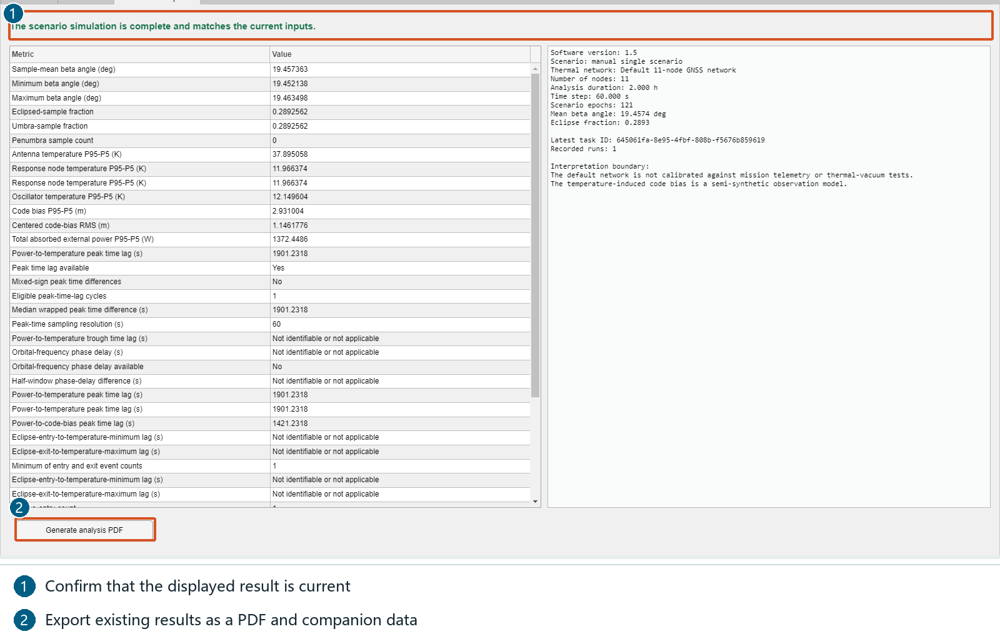

1. Confirm the top result state and the right-hand session summary describe your current inputs.
   If inputs changed, recompute before exporting their report.
2. Read the metrics table, then click **Generate analysis PDF** at ②.
3. Choose a writable parent folder. Open the newly created directory and its `report` subdirectory.
4. Open `thermal_report_en.pdf` or `thermal_report_zh.pdf`, according to the run language. The same
   folder contains figures, CSV evidence and `thermal_report_data.mat`.
5. Start with `thermal_node_statistics.csv`, `thermal_diagnostics.csv`,
   `thermal_conductive_links.csv` and `thermal_metric_definitions.csv` when checking the numbers.

### Illustrated Walkthrough: A Complete Task and Report

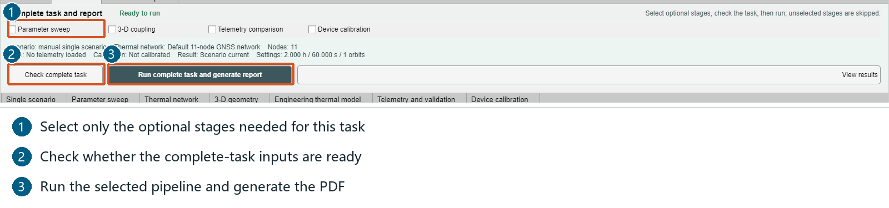

1. Configure inputs on the relevant pages first. At ①, select only the required **Parameter sweep**,
   **3-D coupling**, **Telemetry comparison** or **Device calibration** stages. All four may be
   unchecked for a basic thermal task and report.
2. Click **Check complete task** at ②. Supply missing inputs or uncheck a stage you do not need.
3. Click **Run complete task and generate report** at ③, then select the output parent folder.
4. Inspect `pipeline_status.json`, the saved input/model snapshots, calculation data and report PDF.

This area is available above the Simulation pages, not only on Quick start. It differs from the
page-local buttons: it deliberately runs the selected pipeline and generates its report.

### Illustrated Walkthrough: Start With a Two-Case Sweep

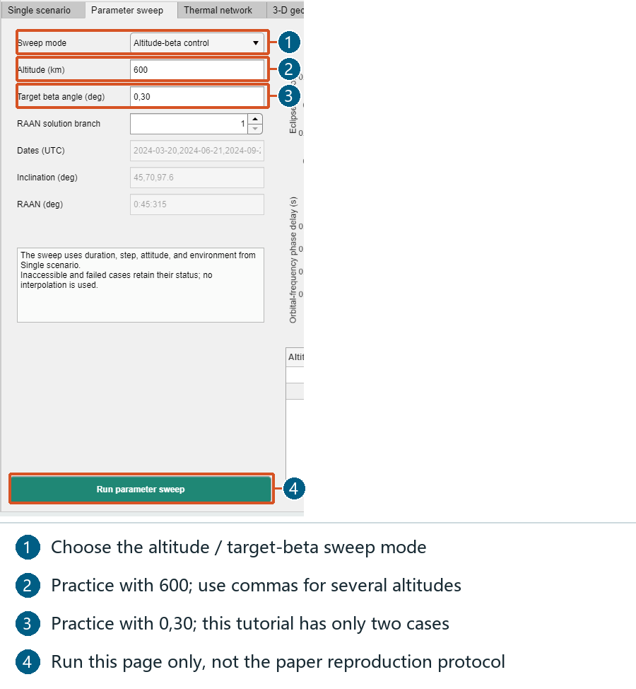

1. Set duration, output sampling, attitude and environment on the Single scenario page; a sweep uses
   these settings and the current network.
2. Open **Parameter sweep**. Select the altitude / target-beta mode, set altitude to `600`, target
   beta to `0,30` and RAAN solution branch to `1`.
3. Click **Run parameter sweep** at ④. This practice run has **two** cases. The illustrated UI
   comes from an actual two-case tutorial calculation, not a cached 36-case paper run.
4. Inspect the page table and plots; use comma-separated values to expand the study later.

An ordinary page sweep does not automatically add the paper's three conductance levels, periodic
initialization or time refinements. Use the paper-reproduction entry point for that protocol.

### Illustrated Walkthrough: Configure the Thermal Network

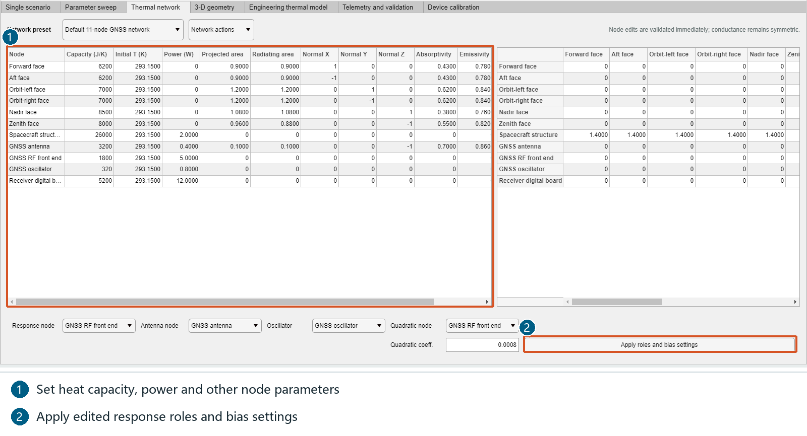

1. Open **Thermal network**. Keep the default 11-node reference preset for the first exercise.
2. Edit the node table for heat capacity (J/K), initial temperature (K), dissipation (W), area (m²),
   normals and optical properties. Scroll horizontally to see later columns.
3. Use row/column node names to edit the conductance matrix (W/K); edits preserve symmetry.
4. If response roles or bias settings change, click **Apply roles and bias settings** at ②.
5. Re-run the scenario afterwards. Changing a table alone does not compute new temperatures.

### Illustrated Walkthrough: Surface, Volume or Coupled Geometry

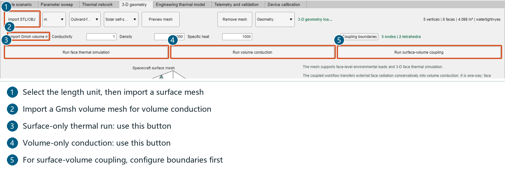

1. Select the file length unit, use **Import STL/OBJ**, then **Preview mesh** to inspect size and
   orientation.
2. For a surface-only calculation, click **Run face thermal simulation**.
3. For volume conduction, use **Import Gmsh volume mesh**, set conductivity (W/(m·K)), density
   (kg/m³) and specific heat (J/(kg·K)), then **Run volume conduction**.
4. For coupled analysis, provide both meshes, configure **Coupling boundaries**, and use
   **Run surface-volume coupling**.
5. To include coupling in a complete-task report, select **3-D coupling** and check the task first.

The screenshot imports `examples/assets/example_coupled_surface.obj` and
`example_two_tetrahedra.msh`, included in the illustrated package. These tiny meshes teach import
and setup, rather than validating a satellite. Replace them with your own research geometry.

### Illustrated Walkthrough: Import and Apply an Engineering Model

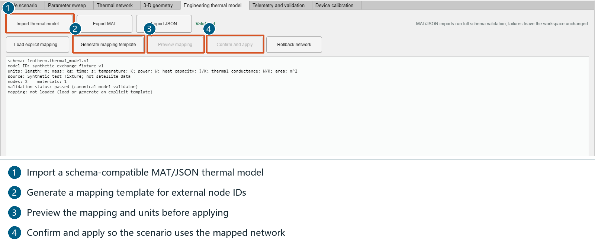

1. **Import thermal model...** accepts the `leotherm.thermal_model.v1` MAT/JSON schema, not arbitrary
   files renamed to these extensions.
   For practice, choose the bundled `examples/projects/06_engineering_model_exchange.json`.
2. Check model, units, nodes, materials and provenance in the summary.
3. Generate or load an explicit node mapping; **Preview mapping** before **Confirm and apply**.
4. Re-run the single scenario after applying the mapped network. **Export MAT**, **Export JSON** and
   **Rollback network** manage the model rather than invoking a separate solver.

### Illustrated Walkthrough: Telemetry Import and Comparison

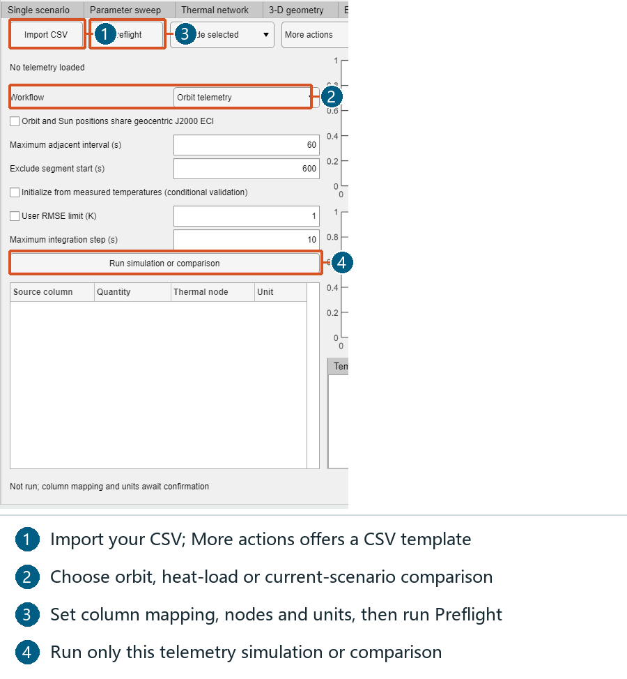

1. **More actions > CSV template** exports a blank template. **Import CSV** loads your data.
2. Assign source columns, quantities, thermal nodes and units in the mapping table.
3. Select **Orbit telemetry**, **Measured heat loads** or **Validate current scenario** under
   Workflow. The third mode needs a previously computed matching scenario.
4. Set allowed adjacent intervals and segment-start exclusion. For orbit driving, confirm common
   geocentric J2000 ECI coordinates only when your data actually use them.
5. Click **Preflight**, resolve data/mapping issues, then **Run simulation or comparison**.
6. Choose a node, inspect curves, residuals, valid scoring samples and statistics; **Export telemetry**
   saves this page's results. **Synthetic demo data** teaches the workflow but is not flight data.

### Illustrated Walkthrough: Bounded Device Calibration

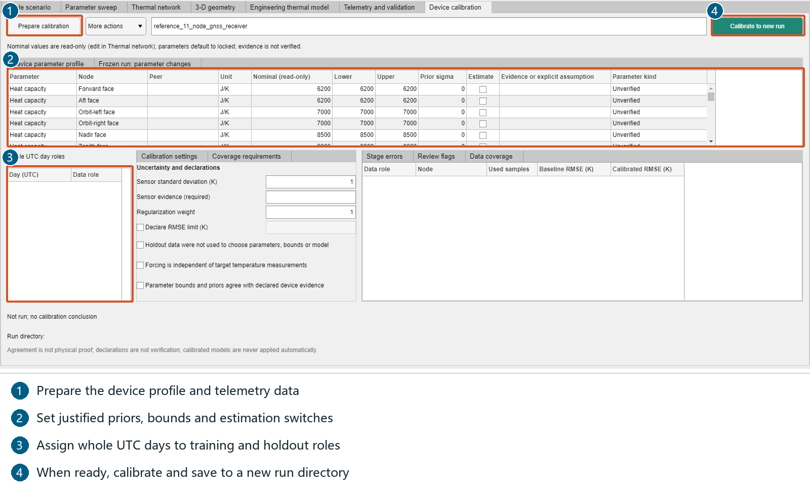

1. Import usable telemetry before opening **Device calibration**. Use **Prepare calibration**;
   **More actions** can load the current device, import a device profile or load telemetry days.
2. Check the read-only nominal values (edit them on Thermal network), then set prior standard
   deviations, estimation switches and justified bounds in the device table.
3. Assign complete UTC days to training and holdout roles; holdout days do not enter fitting.
4. Enter sensor-error evidence and required declarations truthfully.
5. Click **Calibrate to new run**, choose a new destination, inspect parameter changes and save the
   project. This screenshot only shows configuration positions; it does not claim calibration success.

Telemetry and calibration can be skipped when the required data are not available.

### Illustrated Walkthrough: Templates, Projects and Stopping

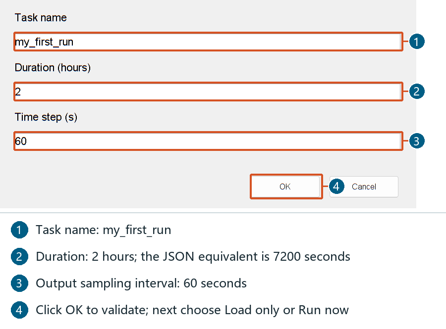

From **Task wizard** in Figure 1, select a built-in template or **Choose another JSON template...**.
Enter task name, **Duration (hours)** and **Time step (s)**, for example `my_first_run`, `2`, `60`.
Choose **Load only** to inspect the configuration, or **Run now** for a complete task. For a local
scenario only, use Load only and then the page-local button. JSON `scenario.durationS` is in seconds
(`7200`), whereas the wizard duration is in hours (`2`).

The header **Save project** / **Open project** controls save and restore the workspace; opening a
project restores its recorded language too.

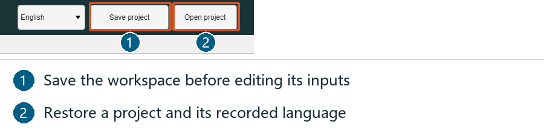

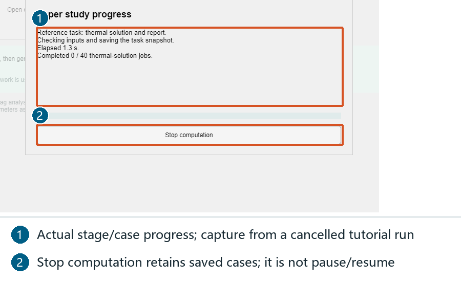

The screenshot comes from a real tutorial paper task stopped after capture. The panel reports the
actual stage and elapsed time. **Stop computation** requests a checkpoint stop, retains saved cases,
and does not pause or automatically resume. An in-progress figure/PDF export finishes before its
next checkpoint. A stopped task is `cancelled`, not `complete`; use a new destination for a new run.

### Interface Reference

The window has three top-level areas:

| Area | Purpose |
| --- | --- |
| **Quick start** | Template shortcuts, project opening, and the paper-reproduction entry point. |
| **Simulation** | The individual module pages. |
| **Results and export** | Inspecting and exporting results of completed work. |

The **Simulation** area contains these pages, each with its own run control:

| Page | What it computes |
| --- | --- |
| Single scenario | One orbital scenario with the current thermal network. |
| Parameter sweep | A matrix of scenarios across altitude, beta angle and conductance. |
| Thermal network | The node capacitances, internal dissipation and the conductive links. |
| 3-D geometry | Surface/volume mesh view and coupled mesh–thermal runs. |
| Engineering thermal model | Import/export of the engineering thermal model (MAT or JSON). |
| Telemetry and validation | Comparison of simulated temperatures against measured telemetry. |
| Device calibration | Estimation of device parameters against a data set. |

Above the Simulation pages sits the separate **Complete task and report** area, which drives the
full pipeline rather than a single module.

---

## 3. Running a single module

1. Open the page you need, for example **Simulation > Single scenario**.
2. Set the scenario and thermal network on the page.
3. Click that page's own run button — for example **Run single scenario**.

Only that scenario runs. Results appear on the same page; no directory chooser opens and no task PDF
is generated automatically.

The same pattern holds for the other pages: **Run parameter sweep** on the sweep page, and separate
surface, volume and coupling run buttons on **3-D geometry**. **Telemetry and validation** and
**Device calibration** have their own run buttons. The network and model pages configure inputs
rather than launching an unrelated solver.

Local runs neither read nor modify the four complete-task stage checkboxes. Modules still consume
their required inputs: a sweep uses the current scenario and network, a telemetry comparison may
require a previously computed scenario, and calibration requires its declared data and run
directory.

---

## 4. Running a complete task

The **Complete task and report** area runs the whole pipeline and writes a self-contained output
directory.

1. Select whichever optional stages you need: **Parameter sweep**, **3-D coupling**,
   **Telemetry comparison**, **Device calibration**.
2. Click **Check complete task**. This reports whether the selected stages have everything they
   need.
3. Click **Run complete task and generate report**.

The pipeline writes the PDF report, the numerical data, the model snapshots and the status records
into a new directory. A selected stage that is not ready blocks the global button but does not
prevent a local module run.

**Quick start** remains a template shortcut. **Current configuration and report** uses the current
settings and selected stages instead of replacing them. **Paper: reference task and 36 cases**
reproduces the published reference task, the 36 conditions and the three refinement runs — see
`reproduce_paper_v1.5.md`.

The **Results and export** page also keeps a deliberate manual PDF export for existing results.
Running a local module never invokes that export automatically.

---

## 5. Command-line interface

Every mode below is a first argument to `LEOTherm.exe`, run from a console. The console prints
progress; the GUI progress dialog is not shown.

| Command | What it does |
| --- | --- |
| *(no argument)* | Opens the graphical interface. |
| `--paper-study DIR [zh\|en\|both]` | Reference task + 36-case study + refinements + report. Language defaults to `both`. |
| `--smoke DIR` | One complete pipeline, ending in a report PDF. |
| `--sample-reports DIR` | Generates the bundled sample reports. |
| `--gui-startup-smoke DIR` | Startup-timing and page-creation check. |
| `--gui-module-smoke DIR` | Module run-button check. |
| `--gui-figure-smoke DIR` | Background figure-export check. |
| `--gui-window-smoke DIR` | Window-state restoration check. |
| `--gui-progress-smoke DIR` | Progress-reporting check. |
| `--gui-smoke DIR` | General GUI smoke test. |
| `--gui-report-window-smoke DIR` | GUI smoke test that also captures the window. |

`DIR` is the output directory. Every mode creates it and refuses to start if the path already
exists, so a new run can never silently overwrite an earlier one. Choose a path that does not exist
yet.

Example — reproduce the paper with both language reports:

```powershell
.\LEOTherm.exe --paper-study "C:\LEOThermResults\paper_run_01" both
```

The `--gui-*` modes are diagnostic entry points used by the release checks. They are safe to run,
but they create windows and are not needed in normal use.

---

## 6. Output files

A complete task writes one directory per run. The reference pipeline produces:

| File or directory | Contents |
| --- | --- |
| `input_snapshot.mat` | The exact inputs the run started from. |
| `frozen_model.mat` | The thermal model as frozen at run time. |
| `pipeline_run.mat` | The full run record. |
| `pipeline_status.json` | Status, stage and heartbeat while running. |
| `report/` | The analysis PDF, plus data and figures (below). |

The report directory contains:

| File | Contents |
| --- | --- |
| `thermal_report_en.pdf`, `thermal_report_zh.pdf` | The complete bilingual analysis reports. |
| `scenario_summary_*.pdf/.png` | Scenario summary page and figure. |
| `detail_*.pdf/.png` | One figure per detail section (capacity, conductance, gradients, heat inputs, illumination, initial state, optics, energy balance, …). |
| `publication_*.pdf/.png` | Publication-ready figure groups, with companion MAT files. |
| `thermal_metric_definitions.csv` | Definition of every reported metric. |
| `thermal_node_statistics.csv`, `thermal_diagnostics.csv` | Per-node temperatures and diagnostics. |
| `thermal_energy.csv`, `thermal_conductive_links.csv` | Energy balance and the conductive-link table. |
| `thermal_sections.csv`, `thermal_interpretation_evidence.csv` | Report sections and the evidence behind each conclusion. |
| `thermal_manifest.json` | Manifest of the report bundle. |
| `thermal_report_data.mat` | Everything needed to re-plot without re-solving. |

The **paper study** writes a different, larger bundle; its files are listed in
`reproduce_paper_v1.5.md`.

---

## 7. Metric definitions

The report computes its conclusions from the run it just performed, never from cached values.

| Metric | Definition |
| --- | --- |
| **P95−P5** | The 95th percentile minus the 5th percentile of the RF-node temperature history. This is a percentile spread, **not** the max-minus-min range. |
| **Orbital-frequency phase delay** | The delay of the temperature response relative to the **total external absorbed power**, derived from a harmonic least-squares fit at the orbital frequency. It is not an intrinsic thermal time constant. |
| **Eclipse fraction** | The fraction of the analysed window spent in Earth shadow. |
| **Normalized hysteresis** | Hysteresis loop area of the temperature–forcing cycle, normalised by the forcing span. |
| **Warmup cycles** | Number of orbits needed to reach periodic steady state under the same-phase criterion. |
| **Periodic error** | Maximum same-phase temperature difference between consecutive orbits at convergence. |

Full definitions, including units, are written to `thermal_metric_definitions.csv` in every report
directory.

---

## 8. Reproducing the published results

The paper's reference task, its 36-case parameter study, its three time-refinement cases and its
verification figures are all produced by one command:

```powershell
.\LEOTherm.exe --paper-study "C:\LEOThermResults\paper_run_01" both
```

The same study can be started from the GUI: **Quick start > Paper: reference task and 36 cases >
Reproduce paper and report**. Choose a writable parent directory; the inputs in your current
workspace are preserved.

From MATLAB source, the equivalent call is:

```matlab
addpath('src');
study = leotherm.runPaperStudy(fullfile(pwd,'results','paper_run_01'),'both');
```

**`reproduce_paper_v1.5.md` documents the frozen inputs, the output files and the numerical checks
that must be satisfied, so that a reader can confirm the published numbers independently.**

---

## 9. Progress, stop and cancellation

During a paper reproduction the progress dialog shows the current case, the integration or
initialization stage, and elapsed time. Completed thermal-solution jobs are counted out of **40**
(one reference task, 36 cases and three refinements); this is a job count, not a time-based
percentage. Figure and PDF generation uses an indeterminate indicator with the actual section or
page count.

Clicking **Stop computation** — the English stop text is *Stop computation*, then *Stopping…* —
requests a checkpoint stop. Closing the main window also stops the task before closing, and prompts
for unsaved project changes where applicable. A native figure or PDF export already in progress
finishes before the next checkpoint.

A stopped run is **retained on disk for inspection** and is marked `cancelled`, never `complete`.
It is not resumed automatically. Saved cases remain valid and can be examined individually.

---

## 10. Templates and tutorials

The package ships task templates that teach the workflow end to end:

| Template | Demonstrates |
| --- | --- |
| `01_first_simulation.json` | A minimal first run. |
| `02_thermal_lag.json` | Thermal lag and response delay. |
| `03_satmo_benchmark.json` | Comparison against an external reference case. |
| `04_telemetry_validation.json` | Comparison of simulation against telemetry. |

Reference models and synthetic examples exist to teach the workflow. Replace them with
mission-specific inputs before using the results for satellite validation.

The bundled videos carry their v1.2.10 labels. They demonstrate parameter setup and the report
workflow; use this manual for the current local and global run buttons.

---

## 11. Notes on filenames, language and windows

- New filenames and generated child-directory names use **ASCII** in either language. A parent
  directory you select yourself is used as-is and is never renamed.
- The interface and report language follow the selected English/Chinese setting. A saved project
  restores the language recorded in it.
- Report figures are generated in **hidden** windows, and window states affected by native chooser
  or graphics operations are restored afterwards. The packaged window-state check verifies this
  behaviour.
- Native Windows file pickers follow the operating system language, not the application language.

---

## 12. Troubleshooting

**The first launch is slow.** Expected: the Runtime cache is being extracted. Later launches reuse
it. Keep an existing compatible Runtime installation rather than reinstalling each time.

**`LEOTherm.exe` does not start.** MATLAB Runtime R2021b must be installed. The executable does not
contain the Runtime.

**A run stops unexpectedly.** Read `paper_study_status.json` (paper study) or `pipeline_status.json`
(pipeline) in the output directory. They record the stage reached, the last heartbeat and the error.
A stopped run is marked `cancelled` and is kept for inspection.

**Numbers differ slightly from the paper.** Compare against the ranges rather than exact digits:
floating-point summation order and MATLAB release build can move the last few digits. The checks in
`reproduce_paper_v1.5.md` are stated as tolerances for this reason.

**A GUI diagnostic mode reports a window-state failure on a remote or headless session.** The
`--gui-*` modes need a real interactive desktop; a session where Windows cannot maximise a window
cannot run them meaningfully.

---

## 13. Related documents

| Document | Contents |
| --- | --- |
| `reproduce_paper_v1.5.md` | Step-by-step reproduction of the published results. |
| `tutorials_v1.5.md` | Guided walkthroughs. |
| `report_v1.5_zh.md` | Report structure (Chinese). |
| `plotting_v1.5_zh.md` | Figure and plotting guide (Chinese). |
| `术语与指标.md` | Metric terminology (Chinese). |
| `patches/PATCH_v1.5.md` | Changes in this release. |
| `usage_v1.5_zh.md` | This manual in Chinese. |

The software is distributed under the MIT License; see `LICENSE` and `NOTICE.md`.
