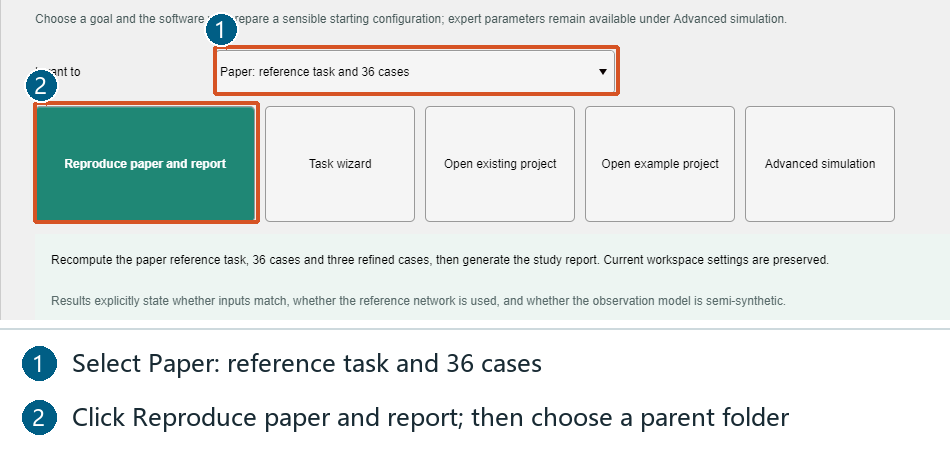
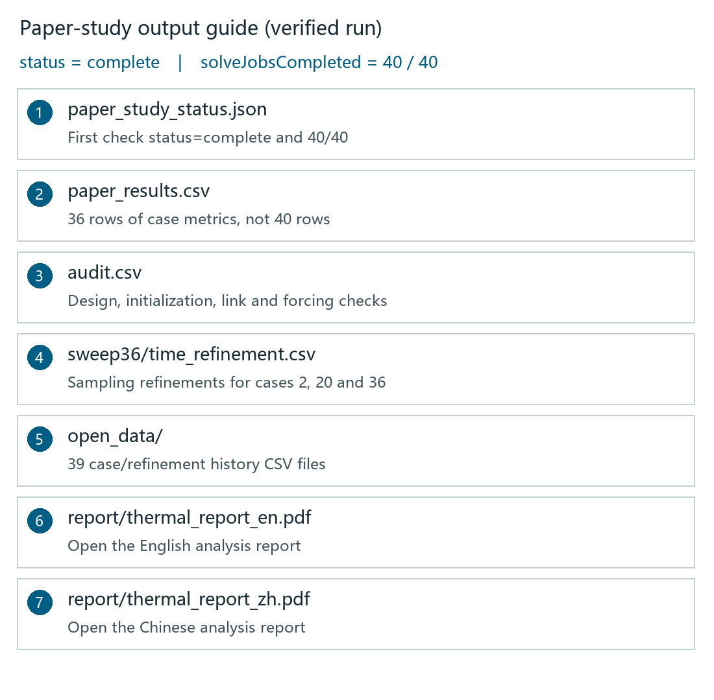
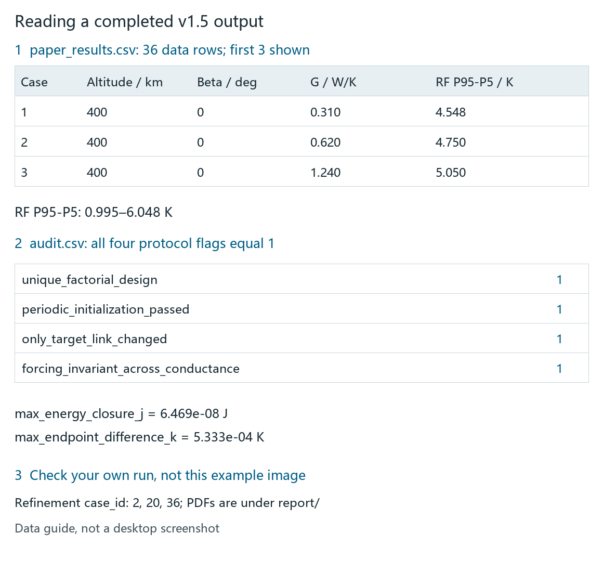

# Reproducing the LEOTherm Paper

This document lists the exact inputs and the numerical checks needed to reproduce the results
published with LEOTherm, independently of the authors. Every number below was obtained by running
the released software on a clean output directory.

If you only want to *use* the software, read `quickstart_v1.5.md` first. This document assumes you are
reproducing a published result and want to confirm it.

---

## 1. Prerequisites

- **MATLAB Runtime R2021b** installed (free — no MATLAB licence is required).
- The LEOTherm release archive extracted to a writable directory.
- Roughly **2 GB** of free disk space and **one to two hours** of wall-clock time for a full study
  on a typical desktop. Individual cases are fast; the 36-case study is the long part.

---

## 2. The single command

### Illustrated GUI Route: Select the Published Study



1. Open `LEOTherm.exe` and stay on **Quick start**. GUI reproduction follows the selected language.
2. At ① choose **Paper: reference task and 36 cases**, not First simulation or an ordinary page sweep.
3. Click **Reproduce paper and report** at ②.
4. In the Windows folder picker, select an existing writable **parent directory**, such as
   `C:\LEOThermResults`. The app creates `paper_<timestamp>_<id>` beneath it. Record the child path.
5. The dedicated study constructs its fixed protocol and preserves current workspace inputs;
   there is no need to fill 36 parameter sets on other pages.

For both report languages, use the command below with `both`. Its path is a **new task destination**,
not the parent selected in the GUI, and must not already exist. Windows picker labels follow the OS.

### Illustrated GUI Route: Monitor the Study


This tutorial screenshot is from an actual task stopped after capture; it demonstrates controls,
not successful completion. A full reproduction has **40 thermal-solution jobs**: one reference,
36 cases and three refinements. Initialization/integration can continue while the completed count
stays unchanged. Figure/PDF generation continues after the solves: wait for final `complete`
status, not merely 40/40. **Stop computation** cancels rather than pauses; saved cases remain, but
the run is `cancelled` and is not automatically resumed. Use a new destination to start again.

### Illustrated GUI Route: Find and Check Your Results



This is a file guide, not an Explorer screenshot. Its file names come from the completed v1.5 Runtime
run. In **your own** newly created directory:

1. Open `paper_study_status.json`: require `status="complete"`, `stage="complete"`, completed/total
   jobs `40/40`, `caseCount=36` and `refinementCount=3`.
2. Open `paper_results.csv`: **36 data rows plus a header**, not 40 rows. Reference/refinement
   results are stored separately.
3. Open `audit.csv`: require `case_count=36` and all **four protocol flags** equal to `1`.
4. Open `sweep36/time_refinement.csv`: require case IDs **2, 20, 36**. Each row compares 360 and 720
   output intervals for the same case, rather than adding a new factorial condition.
5. Open the PDF under `report`; consult `open_data` for histories and the report definition CSV
   for the metric meanings and units.



This data guide is rendered from verified CSV/JSON records, not a desktop screenshot. Check your
own files against the field meanings in Sections 5–6. To inspect without Excel, replace `$run`
with your own directory and run in PowerShell:

```powershell
$run = 'C:\LEOThermResults\paper_run_01'
Get-Content (Join-Path $run 'paper_study_status.json')
$cases = Import-Csv (Join-Path $run 'paper_results.csv')
$cases.Count
$cases | Select-Object case_id,altitude_km,target_beta_deg,effective_thermal_conductance_w_per_k,rf_temperature_p95_p5_k
Import-Csv (Join-Path $run 'audit.csv') | Format-List
Import-Csv (Join-Path $run 'sweep36/time_refinement.csv') | Format-Table
Get-ChildItem (Join-Path $run 'report') -Filter '*.pdf'
```

### Command-Line and MATLAB Routes

A full reproduction is one command. The destination directory **must not already exist** — this is
enforced so a new run can never overwrite an earlier one.

```powershell
.\LEOTherm.exe --paper-study "C:\LEOThermResults\paper_run_01" both
```

The third argument selects the report language: `zh`, `en` or `both`. Omitting it defaults to
`both`.

From the graphical interface, use **Quick start > Paper: reference task and 36 cases > Reproduce
paper and report** and choose a writable parent directory. Your current workspace inputs are
preserved.

From MATLAB source:

```matlab
addpath('src');
study = leotherm.runPaperStudy(fullfile(pwd,'results','paper_run_01'),'both');
```

While the study runs, `paper_study_status.json` in the output directory records the current stage,
a heartbeat, and the completed job count out of **40** (one reference task, 36 cases, three
refinements). Stopping the run leaves a `cancelled` record and keeps every completed case on disk.

---

## 3. Frozen study inputs

The study is a controlled factorial design. Nothing below is chosen at run time; these values are
fixed in the released protocol.

| Input | Values |
| --- | --- |
| Orbital altitude | 400, 600, 800 km |
| Target beta angle | 0°, 30°, 60°, 75° |
| Effective structure-to-RF conductance | 0.31, 0.62, 1.24 W/K |
| Total cases | 3 × 4 × 3 = **36** |
| Orbits analysed per case | 6 |
| Output intervals per orbit | 360 (≈ 15.4 s at 400 km) |
| Periodic initialization criterion | 0.001 K, same-phase, orbit-to-orbit |
| Time-refinement cases | 2, 20 and 36, recomputed at 720 intervals per orbit |

The **reference task** is separate from the 36-case study. It uses the default 11-node model with a
7200 s duration, a 60 s output interval and no warmup. It is the case behind the component-response
figure.

Only the target conductance link is varied between the three conductance levels: the audit confirms
that the forcing is invariant across conductance and that no other link changes.

---

## 4. Output files

The study writes this tree:

| Path | Contents |
| --- | --- |
| `paper_study_status.json` | Stage, heartbeat, completed cases, final status. |
| `paper_results.csv` | One standardised row per case: 25 metrics, including all columns used below. |
| `audit.csv` | The design and closure checks (section 5). |
| `paper_study.mat` | The complete study object. |
| `reference/` | The reference task: input snapshot, frozen model, pipeline run, status, report. |
| `sweep36/` | Per-case MAT files, `sweep36_complete.mat`, `protocol.json`, `time_refinement.csv`, and the three `*_refined.mat` cases. |
| `open_data/` | 39 temperature-history CSVs, e.g. `case_01_h400_b00_g0.31.csv`. |
| `report/` | `thermal_report_en.pdf`, `thermal_report_zh.pdf`, figures, and the definition CSVs. |

Column names in `paper_results.csv` are self-describing. The ones used for the checks below are
`rf_temperature_p95_p5_k`, `orbital_phase_delay_s`, `eclipse_fraction`, `warmup_cycles` and
`periodic_error_k`.

---

## 5. Design and closure checks

`audit.csv` contains a single row that must read as follows:

| Column | Required value | Meaning |
| --- | --- | --- |
| `case_count` | 36 | All cases completed. |
| `unique_factorial_design` | 1 | The 36 cases are distinct combinations. |
| `periodic_initialization_passed` | 1 | Every case reached periodic steady state. |
| `only_target_link_changed` | 1 | No unintended model change. |
| `forcing_invariant_across_conductance` | 1 | The conductance comparison is controlled. |
| `max_energy_closure_j` | ≈ 6.5 × 10⁻⁸ J | Worst-case energy closure across the sweep. |
| `max_endpoint_difference_k` | ≈ 5.3 × 10⁻⁴ K | Worst-case orbit start-to-end temperature difference. |

If any of the five flag columns reads `0`, the study is not a valid controlled experiment and the
comparisons below do not apply.

Note that `max_energy_closure_j` here is the **cumulative** closure over a whole run. It is not the
same quantity as the reference task's interval residual, which the report gives as
≈ 2.0 × 10⁻⁹ J per step. Do not compare the two directly.

---

## 6. Expected numbers

These are the published results, with the file each one comes from.

### 6.1 Temperature spread (`paper_results.csv`)

| Quantity | Published value | Where to look |
| --- | --- | --- |
| RF-node P95−P5 across all 36 cases | **0.995 – 6.048 K** | min/max of `rf_temperature_p95_p5_k` |
| Minimum case | 400 km, 75°, 1.24 W/K | the row holding the minimum |
| Maximum case | 800 km, 30°, 1.24 W/K | the row holding the maximum |

P95−P5 is the 95th minus 5th percentile of the temperature history — **not** the max-minus-min
range. The definitions are written to `report/thermal_metric_definitions.csv`.

### 6.2 Orbital-frequency phase delay (`paper_results.csv`)

| Quantity | Published value |
| --- | --- |
| Phase delay across all 36 records | **37.18 – 43.43 min** |
| Harmonic fit available for all cases | `harmonic_available = 1` |

The phase delay is measured relative to the total external absorbed power, not against an intrinsic
thermal time constant.

### 6.3 Effect of raising the effective thermal conductance from 0.31 to 1.24 W/K

This is the comparison the paper's orbital-conditions figure is built from. Twelve
(altitude, beta) pairs are compared; nine are eclipsing and three are in continuous sunlight.

| Regime | Pairs | Published change in P95−P5 |
| --- | --- | --- |
| Eclipsing | 9 | **+8.4 % to +39.7 %** |
| Continuous sunlight | 3 | **−10.5 % to −12.1 %** |
| Phase-delay reduction | 12 | **36.8 s to 131.0 s** |

A pair counts as continuous sunlight when `eclipse_fraction = 0` (beta = 75° at every altitude).

### 6.4 Numerical convergence

| Quantity | Published value |
| --- | --- |
| Warmup orbits to periodic steady state | **16 – 19** |
| Worst same-phase periodic error across cases | ≈ 5.1 × 10⁻⁴ K |

### 6.5 Time refinement (`sweep36/time_refinement.csv`)

Cases 2, 20 and 36 are solved again at half the output step. The differences must stay small:

| Quantity | Published value |
| --- | --- |
| Largest temperature difference | **0.219 K** (case 2) |
| RF-span difference | **< 0.0006 K** |
| Harmonic-delay difference | **< 0.13 s** |

### 6.6 Reference task energy balance

| Quantity | Published value | Where to look |
| --- | --- | --- |
| Stored-energy change vs integrated net heat | **−1765.6 kJ** | `reference/report/thermal_energy.csv` |
| Largest absolute interval residual | ≈ 2.0 × 10⁻⁹ J | `reference/report/thermal_diagnostics.csv` |

---

## 7. Reproducing the figures

| Paper figure | How to obtain it |
| --- | --- |
| **Fig. 3** Reference thermal conductance matrix | Read the conductive-link table in `reference/report/thermal_conductive_links.csv`. The default network has 15 symmetric links; the same table is printed by the Thermal network page. |
| **Fig. 4** Component temperature response | `reference/report/` — the scenario summary figure and the node statistics in `thermal_node_statistics.csv`. |
| **Fig. 5** Orbital and mounting conditions | `report/publication_*.png` (and the vector PDFs). Each group has a companion MAT file for re-plotting. |
| Supplementary figures S1–S5 | The synthesis and energy-balance groups in `report/`, produced in both languages. |

Publication figures are exported as PNG and as vector PDF, so they can be placed in a manuscript
directly. Temperature samples and physical parameters are identical to the interactive run.

---

## 8. Additional module examples

The paper's final example section uses modules that are not part of the 36-case study. They run
independently and are much faster.

**Device calibration.** The bundled synthetic demo has a known ground truth: the device heat
capacity used to generate the data is 110 J/K, while the starting model uses 100 J/K. Calibration
recovers 109.99 J/K, and the calibration residual falls from ≈ 0.6–0.8 K before fitting to
≈ 0.0023 K after. The demo excludes the first 20 s of each day to avoid the initial transient. The
per-split values are listed in the supplementary table of the paper.

**3-D geometry and coupling.** The 3-D page has separate surface, volume and coupling run buttons.
Its outputs are written beside the scenario results.

**Telemetry comparison.** Requires a previously computed scenario; it reports agreement metrics and
an assessment per temperature node in `thermal_node_status`-style outputs.

---

## 9. Tolerances

Compare against the **ranges** in section 6, not against exact digits. The last two or three digits
of an individual metric can move with:

- the MATLAB release and BLAS build used by the Runtime,
- floating-point summation order in the energy accounting,
- the operating system's thread scheduling in the parallel job pool.

The published ranges are wide enough to absorb all of these. A P95−P5 that lands outside
0.995–6.048 K, or a phase delay outside 37.18–43.43 min, indicates a genuinely different run
rather than rounding.

---

## 10. What counts as a successful reproduction

A reproduction is successful when all of the following hold:

1. `paper_study_status.json` ends with status `complete` and 40 of 40 jobs completed.
2. All five flag columns in `audit.csv` read `1`.
3. `paper_results.csv` has exactly 36 rows and its P95−P5 and phase-delay ranges match section 6.
4. The eclipsing and continuous-sunlight conductance effects match section 6.3.
5. `sweep36/time_refinement.csv` matches section 6.5.
6. Both `report/thermal_report_en.pdf` and `report/thermal_report_zh.pdf` exist.

`open_data/` contains the temperature histories behind every case, so each of these checks can be
recomputed from the raw samples rather than taken on trust.

---

## 11. If something does not match

**The run stopped part-way.** Read `paper_study_status.json`: it records the stage reached and the
last heartbeat. Completed cases remain on disk and are individually valid. The directory is marked
`cancelled`, not `complete`, and is not resumed automatically.

**A metric is empty or `NaN`.** Check `harmonic_available` for that row. The harmonic phase metric
requires a resolvable orbital-frequency component; a row where the fit is unavailable is reported as
such rather than filled with a substitute value.

**The destination directory error appears immediately.** `--paper-study` refuses to write into an
existing directory. Choose a new path.

**Numerical results are close but not identical.** See section 9. Reproducibility here means
agreement within the published ranges and satisfaction of the audit checks, which is the standard
the software is tested against.
