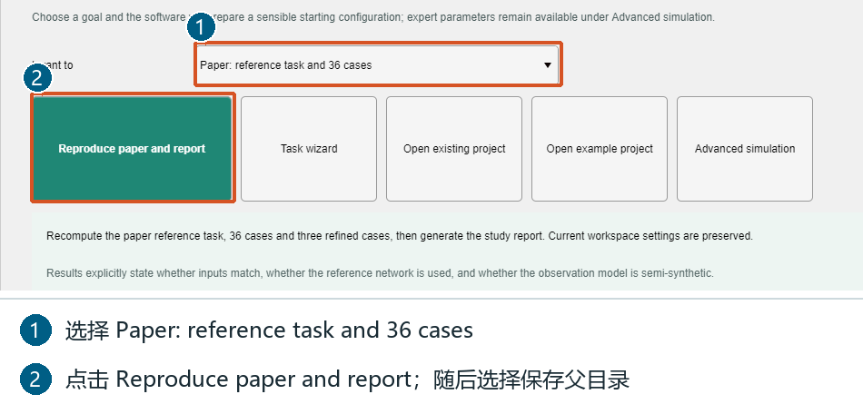
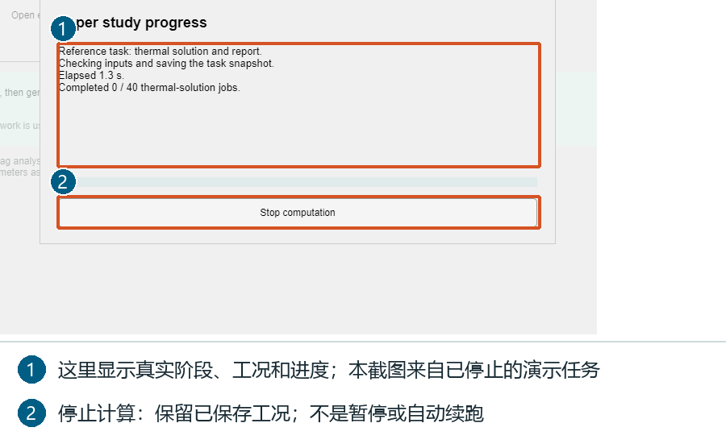
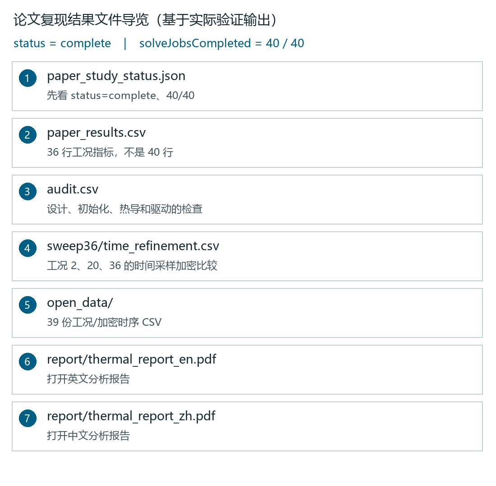
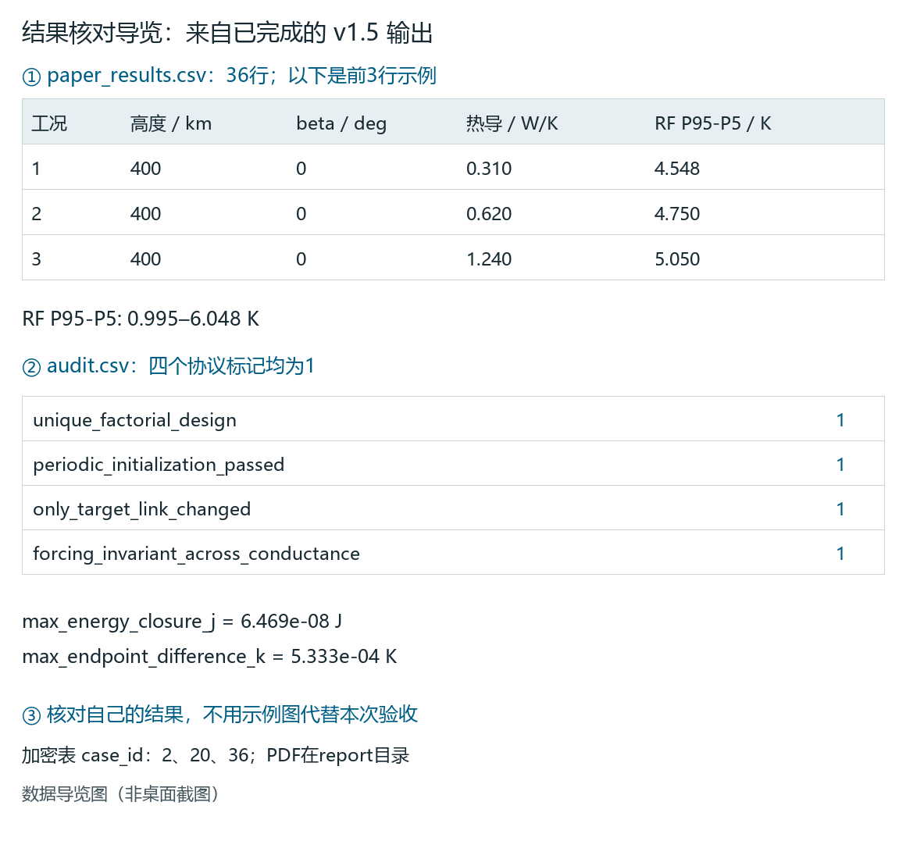

# LEOTherm 1.5 论文复现图解手册

本手册从点击入口讲到结果核对。界面图来自 v1.5；数据导览来自已完成的 Runtime 验证输出。验收时使用**你自己新运行生成的文件**，不要把教程图片当作本次计算成功的证明。

前提：免费 MATLAB Runtime R2021b 已安装、发行包完整解压、结果目录可写。计算时间取决于主机；不要以截图用时作为预计完成时间。

## 1. 选择正确入口



1. 打开 EXE，停留在 `Quick start`。GUI 报告跟随所选语言；要中文报告，先在右上角切换中文。
2. ① 选择 `Paper: reference task and 36 cases`（复现论文：参考任务与36工况）。不要选择 First simulation，也不要在普通扫描页手工拼接。
3. ② 点击 `Reproduce paper and report`（复现论文并生成报告）。
4. 在 Windows 目录选择框中选择可写的**保存父目录**，如 `C:\LEOThermResults`。软件创建 `paper_<时间戳>_<标识>` 子目录，记下它的路径。
5. 不必逐页填写 36 组参数或更改四个阶段勾选项。专用入口构造固定协议，并保留当前工作区设置。

Windows 文件选择框语言跟随操作系统。GUI 输出当前语言；一次计算需要中英两份报告时，用第 3 节命令的 `both`。

## 2. 看进度并等待报告完成



1. 查看当前参考任务/工况、初始化或积分阶段及用时。
2. **40 = 1 个参考任务 + 36 个主工况 + 3 个加密算例**。完成数不等于剩余时间比例。
3. 一组工况还在预热或积分时，已完成数可以不变；不要重复点击运行。
4. 达到 40/40 后仍要生成图形与 PDF；**最终 status=complete 才是整套任务完成**。
5. 完整复现时不要点 `Stop computation`。它是取消，不是暂停；保存的数据保留，但状态是 `cancelled`，不会自动续跑。

这张界面图来自真实启动后停止的教程任务，只演示控件；不是完成截图。

## 3. 命令行方式：一次生成两种语言

在 EXE 所在目录打开 PowerShell：

```powershell
.\LEOTherm.exe --paper-study "C:\LEOThermResults\paper_run_01" both
```

这里是**尚不存在的新任务目录**，不是 GUI 选择的父目录。已存在则改为 `paper_run_02`。语言可选 `en`、`zh`、`both`，默认 both。

源码运行（需要 MATLAB 许可证）：

```matlab
addpath('src');
study = leotherm.runPaperStudy(fullfile(pwd,'results','paper_run_01'),'both');
```

## 4. 固定实验协议

| 项目 | 设置 |
| --- | --- |
| 轨道高度 | 400、600、800 km |
| 目标 beta 角 | 0°、30°、60°、75° |
| 结构—射频前端有效热导 | 0.31、0.62、1.24 W/K |
| 主工况数 | 3 × 4 × 3 = 36 |
| 每工况分析 | 周期初始化后 6 圈 |
| 周期初始化阈值 | 同相位相邻圈温差 0.001 K |
| 输出采样 | 每圈 360 区间，不是所有高度同一秒数 |
| 加密比较 | 工况 2、20、36，每圈 720 区间 |
| 参考任务 | 默认11节点，7200 s，60 s输出，不预热 |

两小时入门例与普通两因素扫描不能替代这个协议。

## 5. 找到报告和原始数据



这是文件导览，不是资源管理器截图。在自己的新运行目录中查找：

| 文件/目录 | 内容 |
| --- | --- |
| paper_study_status.json | 阶段、最终状态和40/40任务 |
| paper_results.csv | 36行主工况参数和指标 |
| audit.csv | 协议检查、能量闭合和端点温差 |
| sweep36/time_refinement.csv | 2、20、36的采样加密比较 |
| open_data/ | 39份主工况与加密时序CSV |
| reference/ | 参考任务快照、运行和报告数据 |
| report/ | 本次PDF、图形和指标定义 |
| paper_study.mat | 完整研究记录 |

按所选语言打开 `report/thermal_report_zh.pdf` 或 `thermal_report_en.pdf`；只有 both 才要求两份都生成。

## 6. 按字段验收：不是只看PDF存在



本图将实际 CSV/JSON 数据排成导览，非虚构桌面。自己的结果需要：

1. 状态文件 `status=complete`、`stage=complete`、`solveJobsCompleted=40`、`solveJobsTotal=40`、`caseCount=36`、`refinementCount=3`。
2. `paper_results.csv` **36行数据，另有表头**，不是40行；参考任务和加密单独保存。
3. `audit.csv` 的 `case_count=36`，下面四个检查均为1。
4. `time_refinement.csv` 包含 case_id 2、20、36。
5. 所选语言PDF存在且能打开，CSV/MAT和图形保留。

| audit字段 | 值为1的含义 |
| --- | --- |
| unique_factorial_design | 36组三因素组合完整且不重复 |
| periodic_initialization_passed | 满足周期初始化条件 |
| only_target_link_changed | 热导试验只改变指定连接 |
| forcing_invariant_across_conductance | 同轨道三档热导使用相同外部驱动 |

验证输出的 `max_energy_closure_j` 约 `6.47e-8 J`，`max_endpoint_difference_k` 约 `5.33e-4 K`，分别是累计能量闭合量和周期端点温差，不是温度预测误差。

无需Excel也能查看。将 `$run` 换成自己的路径后执行：

```powershell
$run = 'C:\LEOThermResults\paper_run_01'
Get-Content (Join-Path $run 'paper_study_status.json')
$cases = Import-Csv (Join-Path $run 'paper_results.csv')
$cases.Count
$cases | Select-Object case_id,altitude_km,target_beta_deg,effective_thermal_conductance_w_per_k,rf_temperature_p95_p5_k
Import-Csv (Join-Path $run 'audit.csv') | Format-List
Import-Csv (Join-Path $run 'sweep36/time_refinement.csv') | Format-Table
Get-ChildItem (Join-Path $run 'report') -Filter '*.pdf'
```

## 7. 哪些指标对应论文结果

| 列名 | 含义与单位 |
| --- | --- |
| altitude_km / target_beta_deg | 高度与目标beta角 |
| effective_thermal_conductance_w_per_k | 结构—射频前端有效热导（W/K） |
| rf_temperature_p95_p5_k | RF第95减第5百分位温度跨度（K） |
| orbital_phase_delay_s | 温度相对总外部吸收功率的轨道频率相位时延（s） |
| harmonic_available | 1表示谐波指标可用 |
| eclipse_fraction | 分析窗口入影比例，0是持续光照 |
| warmup_cycles / periodic_error_k | 初始化圈数与收敛温差 |

RF P95−P5 约 **0.995–6.048 K**；热导 0.31→1.24 W/K 时，9组入影组合增大 **8.4%–39.7%**，3组持续光照组合减小 **10.5%–12.1%**；12组组合的相位时延缩短 **36.8–131.0 s**。

相位时延总体约37.18–43.43 min，是周期驱动的相位换算，不是设备本身的热时间常数。比较热导时，在**相同高度、相同beta**的三行中比较，不要用不同轨道两行计算热导效果。

加密比较：最大节点温差约0.219 K（工况2）；RF跨度差小于0.0006 K；谐波时延差小于0.13 s。这三个量对应不同指标。

## 8. 重新运行与停止后的处理

1. 重新运行用新目录，不覆盖或拼接两次结果。
2. cancelled目录可查看已保存工况，但不是完整复现，不自动续跑。
3. 偏离时对照协议、audit与指标定义，不通过删工况来达到论文范围。
4. 其他功能练习见[图解用户手册](usage_v1.5_zh.md)，不属于36工况主研究。

详细英文协议见[英文论文复现手册](reproduce_paper_v1.5.md)，软件操作见[图解用户手册](usage_v1.5_zh.md)。
