# LEOTherm 1.5 图解用户手册

本手册按“开始 → 设置 → 运行 → 查看 → 导出”说明操作。截图来自 v1.5 实际界面；橙框圈出操作位置，蓝色编号对应图下说明。截图使用默认英文界面，正文给出中文含义。打开离线 HTML 可点击图片查看原始尺寸。

**先选目的：**只算一个场景，读第 3 节；比较多个工况，读第 6 节；所选功能一起运行并出 PDF，读第 5 节；复现论文，使用[论文复现图解手册](reproduce_paper_v1.5_zh.md)。

## 1. 安装与启动

1. 安装免费的 **MATLAB Runtime R2021b**。已有兼容 Runtime 时不必重复安装，不需要 MATLAB 许可证。
2. 完整解压 `LEOTherm_1.5_windows_release_illustrated.zip`，例如解压到 `C:\LEOTherm`。保留模板、图片与手册的相对位置，不直接在 ZIP 里面运行。
3. 双击 `LEOTherm.exe`。第一次启动需建立 Runtime 缓存；等待主界面显示，不反复重启。
4. 右上角 `English` 下拉框可以切换中文。Windows 原生文件选择框使用操作系统语言。

本图解版只更新说明材料，保留原发行版已经验证的 EXE。

## 2. 快速开始：从哪里进入

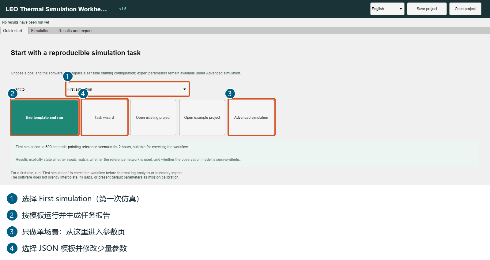

第一次使用且希望直接得到报告：

1. ① `I want to` 选择 `First simulation`（第一次仿真）。
2. ② 点击 `Use template and run`（使用模板并开始仿真）。这会使用预设场景运行完整任务，不是单场景局部按钮。
3. 在随后弹出的目录选择框中，选择**结果保存父目录**，例如 `C:\LEOThermResults`。软件新建任务子目录，不要求把结果放在安装目录。
4. 等待完成，查看任务报告与数据。首次练习无需网格、遥测或设备档案。

只想修改参数并计算单场景时，点击 ③ `Advanced simulation`。④ `Task wizard` 是 JSON 模板向导。模板快捷运行会替换未保存的场景与网络配置，请先保存自己的项目；论文复现入口则保留当前工作区设置。

## 3. 单场景：照着填写并只运行一次

进入 `Simulation → Single scenario`（仿真 → 单场景）。窗口较小时向下滚动输入区，`Run single scenario` 固定在输入区底部。

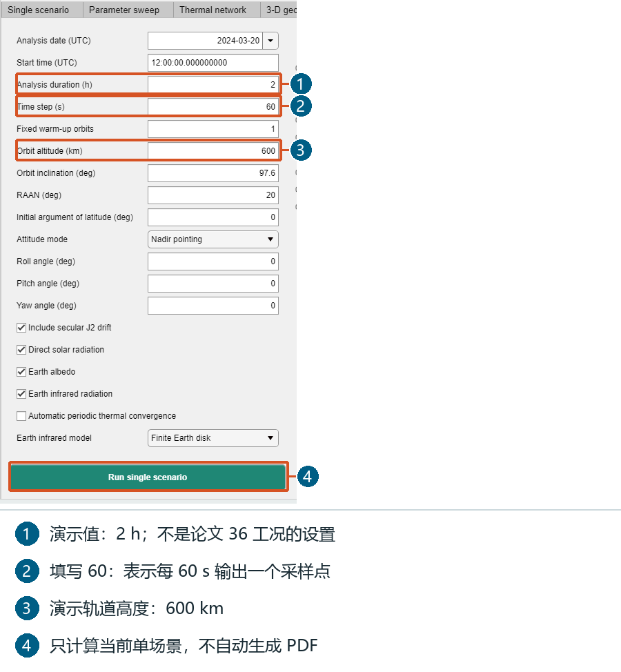

| 字段 | 练习设置 | 含义 |
| --- | --- | --- |
| Analysis date (UTC) | 2024-03-20 | 协调世界时起始日期 |
| Start time (UTC) | 12:00:00 | 起始时刻，不是本机时间 |
| Analysis duration (h) | 2 | 分析时长 2 小时 |
| Time step (s) | 60 | 输出采样间隔 60 秒 |
| Fixed warm-up orbits | 1 | 分析前先积分 1 圈 |
| Orbit altitude (km) | 600 | 高度 600 km |
| Orbit inclination (deg) | 97.6 | 轨道倾角 |
| RAAN (deg) | 20 | 升交点赤经 |
| Initial argument of latitude (deg) | 0 | 初始轨道相位 |
| Attitude mode | Nadir pointing | 对地定向 |
| Roll / Pitch / Yaw angle (deg) | 0 / 0 / 0 | 姿态偏置 |
| Automatic periodic thermal convergence | 不勾选 | 本练习用固定预热圈数 |

太阳直射、反照和地球红外保持默认勾选；红外模型保持 `Finite Earth disk`。

1. 按表设置；不用更改上方完整任务的勾选项。
2. 点击图中 ④ `Run single scenario`。**只计算当前场景**，不自动跑扫描、三维、遥测或标定。
3. 完成后本页显示曲线，也可进入 `Results and export` 查看指标。
4. 本页运行不自动生成 PDF，也不弹出报告保存目录；需要 PDF 时按下一节导出。

这些值是入门练习，不是论文 36 工况协议。`Time step` 表示输出采样间隔，不等于求解器内部每次积分的步长。

## 4. 结果与导出：主动生成分析 PDF

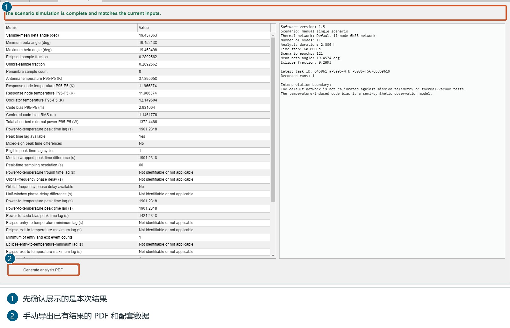

1. 打开 `Results and export`。看顶部状态和右侧任务摘要，确认结果对应当前输入；改参数后要重新计算。
2. 左侧表格是温度与响应指标，右侧摘要记录场景和已执行内容。
3. 点击 ② `Generate analysis PDF`，选择可写的保存父目录。
4. 打开新导出目录的 `report` 子目录，查看 `thermal_report_en.pdf` 或 `thermal_report_zh.pdf`，按本次语言设置生成。
5. 同目录保留图形、CSV、MAT。优先检查 `thermal_node_statistics.csv`、`thermal_diagnostics.csv`、`thermal_conductive_links.csv` 和 `thermal_metric_definitions.csv`。

P95−P5 是第 95 与第 5 百分位温度之差，不是最高温减最低温。指标名称、单位和定义都可在定义 CSV 中查到。

## 5. 完整任务：可选功能一起运行并出报告

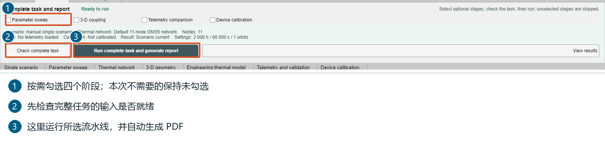

这个区域位于仿真各页上方，不只在快速开始页可用。

1. 先在各页准备设置。① 按需选择四个阶段；四项都不勾选也能做基础热仿真并出报告。
2. 点击 ② `Check complete task`。补齐提示缺少的输入，或取消本次不需要的阶段。
3. 点击 ③ `Run complete task and generate report`，选择保存父目录。
4. 完成后查看 `pipeline_status.json`、模型快照、计算数据及 `report` 中的 PDF。报告只包含实际执行阶段的内容。

| 阶段 | 所需准备 | 作用 |
| --- | --- | --- |
| Parameter sweep | 扫描模式、范围和当前场景 | 比较多个工况 |
| 3-D coupling | 表面/体网格、材料、耦合边界 | 表面—体传热 |
| Telemetry comparison | CSV、列映射、单位、有效样本 | 与遥测比较 |
| Device calibration | 设备档案、参数范围、训练日期与数据 | 估计后将参数用于任务 |

上方完整任务按钮与各页自己的按钮不同：前者跑所选流水线并出报告，后者只算当前模块。

## 6. 参数扫描：从两个工况开始

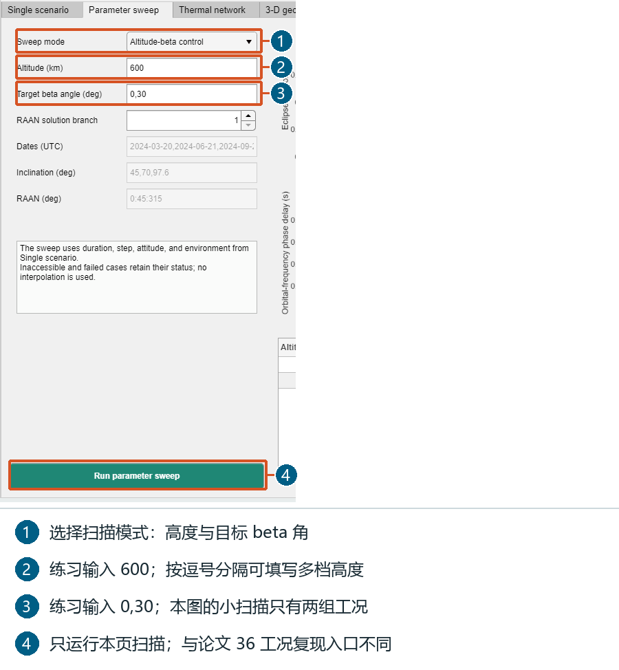

1. 先在单场景页准备时长、采样、姿态和环境；扫描沿用这些设置及当前网络。
2. 进入 `Parameter sweep`，选择高度与目标 beta 角扫描。
3. `Altitude (km)` 填 `600`；`Target beta angle (deg)` 填 `0,30`；RAAN 解分支填 `1`。
4. 点击 `Run parameter sweep`。此练习是 **1 个高度 × 2 个 beta 角 = 2 个工况**，图中对应实际小扫描。
5. 看右侧表格与曲线；以后可用逗号列表，如 `400,600,800`，增加档位会增加计算量。

普通扫描不自动包含论文的三档结构—射频前端热导、周期初始化和步长加密。论文 36 工况请用论文复现入口。

## 7. 热网络：修改物理参数后重新计算

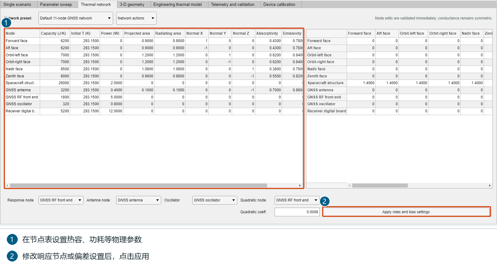

1. 进入 `Thermal network`，默认是 11 节点参考网络；没有设备参数时先保持默认。
2. 左表设置热容（J/K）、初始温度（K）、功耗（W）、面积（m²）、法向和光学属性，横向滚动可看后续列。
3. 右侧导热矩阵设置节点间热导（W/K），按行、列节点名找连接；软件保持矩阵对称。
4. 改响应节点、天线、振荡器或偏差设置后，点 `Apply roles and bias settings`。
5. 回到单场景页重新运行；只改表格不会自动生成新结果。

默认内部节点可通过导热交换热量；对外投影/辐射面积为零不等于没有传热。设备参数应以设备资料为依据。

## 8. 三维：按目的选择表面、体或耦合

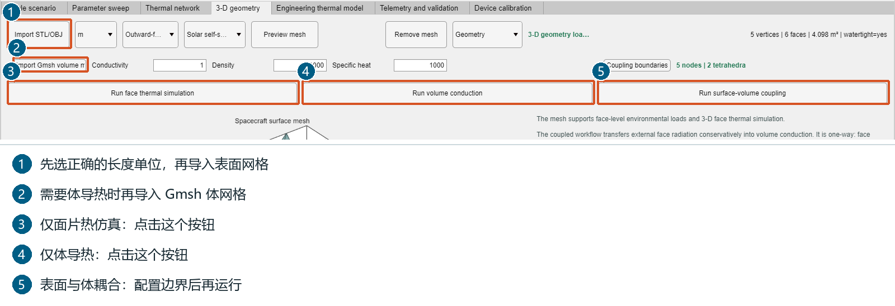

1. `3-D geometry` 中先选文件长度单位，再用 `Import STL/OBJ` 导入表面；点 `Preview mesh` 核对尺寸、朝向和面片。
2. 只算面片时点击 `Run face thermal simulation`，无需体网格。
3. 体导热需要 `Import Gmsh volume mesh`，并设置导热系数（W/(m·K)）、密度（kg/m³）、比热（J/(kg·K)）；点 `Run volume conduction`。
4. 表面—体耦合需要两类网格；先用 `Coupling boundaries` 设置接触和边界，再点 `Run surface-volume coupling`。
5. 希望任务报告包含该项时，在完整任务区勾选 `3-D coupling`，检查后运行。

本图使用发行包 `examples/assets/example_coupled_surface.obj` 和 `example_two_tetrahedra.msh` 演示导入，不是实际卫星验证。这两个极小网格用于熟悉输入；实际研究请换成自己的兼容网格。

## 9. 工程热模型交换

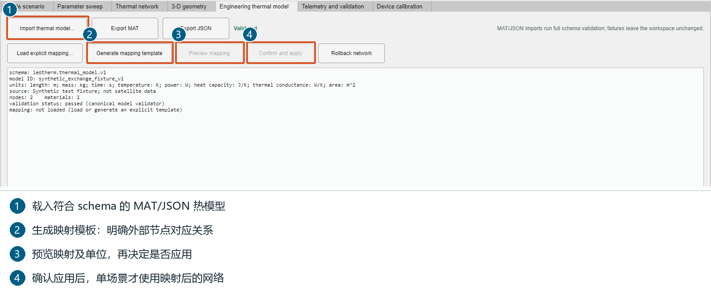

1. `Import thermal model...` 接受符合 `leotherm.thermal_model.v1` 的 MAT/JSON；不能把任意文件改后缀后直接用。
   入门可选择发行包的 `examples/projects/06_engineering_model_exchange.json`。
2. 核对摘要中的单位、节点、材料与来源。
3. 需要转为当前热网络时，生成或载入显式映射模板，指定外部节点的对应关系。
4. 点 `Preview mapping`，确认后点 `Confirm and apply`；回单场景页重新计算。
5. `Export MAT` / `Export JSON` 保存当前规范模型；`Rollback network` 恢复网络。

## 10. 遥测：先映射、预检，再比较

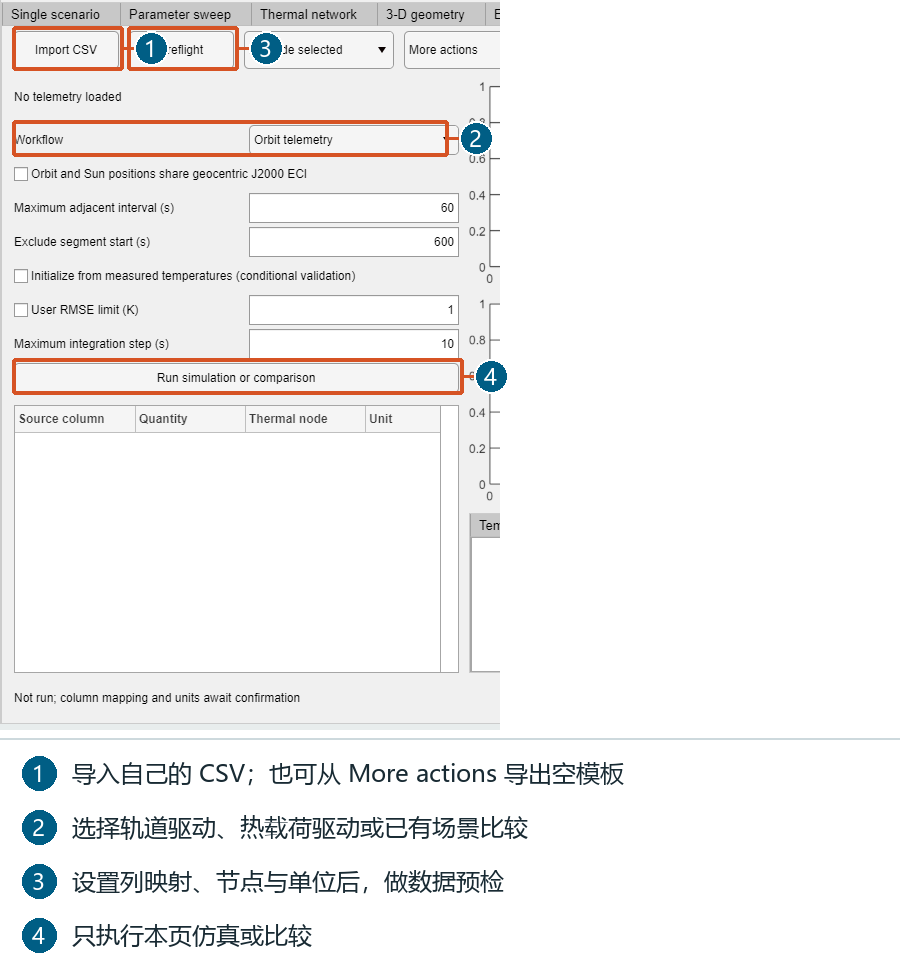

1. 无数据时可从 `More actions → CSV template` 导出空模板；有数据则点 `Import CSV`。
2. 在左侧列映射表指定源列、物理量、热节点与单位。
3. `Workflow` 选择 `Orbit telemetry`（轨道驱动）、`Measured heat loads`（热载荷驱动）或 `Validate current scenario`（比较已有场景）；第三种需先计算对应场景。
4. 设置最大相邻时间间隔与起始排除时长。轨道驱动时确认轨道与太阳位置同为地心 J2000 惯性系，只有满足时才勾选相应声明。
5. 点 `Preflight`，处理数据、单位或映射问题，再点 `Run simulation or comparison`。
6. 选择节点查看曲线、残差、有效评分样本和统计；用 `Export telemetry` 导出本页结果。

`Synthetic demo data` 是合成教程数据，不是在轨实测。软件不自动插值填补缺测；没有遥测时跳过该阶段即可。

## 11. 设备标定：约束参数与训练日期

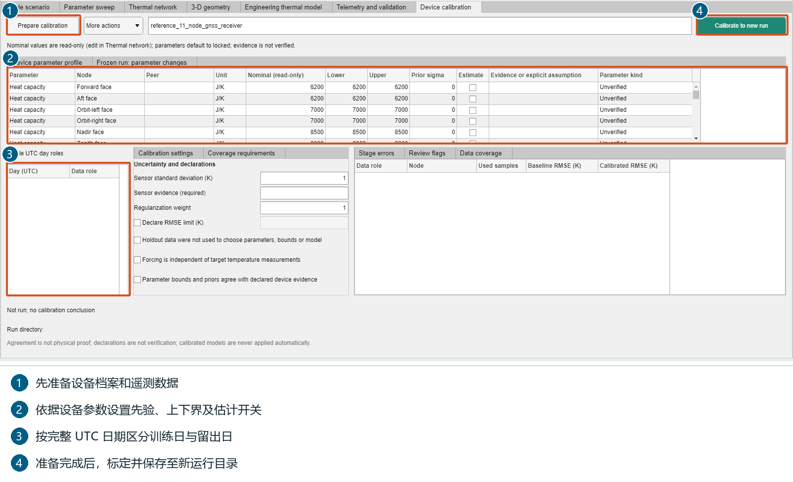

1. 先导入可用遥测，再进入 `Device calibration`。
2. 用 `Prepare calibration` 准备；`More actions` 可载入当前设备、导入设备档案或载入遥测日期。
3. 核对名义值（只读，要修改请到热网络页）；在参数表设置先验标准差、估计开关及上下界，范围应有设备依据。
4. 按完整 UTC 日分配训练与留出角色；留出日不参与拟合。
5. 填写传感器误差依据和所需声明，满足事实后才确认。
6. 点 `Calibrate to new run`，选择新运行位置；检查估计值及相对先验的变化，然后保存项目。

本图只展示配置位置，没有虚构成功结果。缺少设备依据或遥测时可跳过标定。

## 12. 模板和项目：少填参数、保存自己的设置

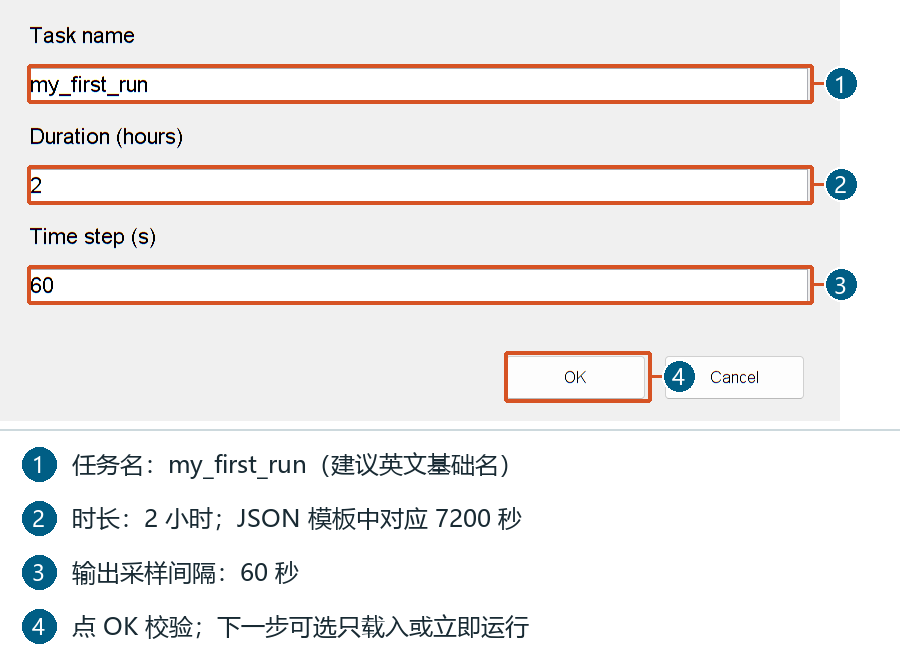

1. 快速开始点 `Task wizard`，选择内置模板或 `Choose another JSON template...`。
2. 输入框依次填写任务名、`Duration (hours)`、`Time step (s)`；例：`my_first_run`、`2`、`60`。
3. 校验后选 `Load only` 只加载，或 `Run now` 运行完整任务。想只算单场景，应先选 Load only，再用单场景局部按钮。
4. 文件方式：复制 `templates/01_first_simulation.json`，修改 `scenario.durationS` 和 `scenario.timeStepS`，再导入。JSON 时长单位是秒，如 7200，而向导时长单位是小时，如 2。
5. 右上角 `Save project` 保存工作区；`Open project` 恢复。打开项目还会恢复它保存时的语言。

## 13. 进度、停止与关闭

1. 面板展示阶段、当前工况、初始化/积分进度和用时；不是预估剩余时间。
2. `Stop computation` 请求停止，变为 `Stopping...`；它不是暂停，不自动续跑。
3. 检查点停止保留已保存工况；正在执行的单次图形/PDF 导出会结束后响应下一检查点。
4. 任务标记 `cancelled`，不是 `complete`；重新运行请用新目录。
5. 运行时关闭主窗口会先请求停止，并处理未保存项目。

图来自实际启动后停止的教程任务，只用于展示进度控件；完成验收见论文复现手册。

## 14. 常见问题

| 情况 | 下一步 |
| --- | --- |
| 双击 EXE 不启动 | 检查 Runtime 为 R2021b，ZIP 已完整解压 |
| 第一启动慢 | 等待缓存建立，不反复重启或删除 Runtime 文件 |
| 想只算一次却跑了更多 | 使用单场景底部 Run single scenario，不用完整任务或论文按钮 |
| 改参数后仍是旧曲线 | 重算相应模块，然后导出 |
| 完整任务按钮不可用 | Check complete task，补齐输入或取消多余阶段 |
| 找不到结果 | 查看选定父目录中新建的任务目录及 report 子目录 |

配套：[论文复现图解手册](reproduce_paper_v1.5_zh.md)、[英文用户手册](quickstart_v1.5.md)、[发布验证记录](verification_v1.5_release.md)。

各模块页面首次使用时加载。随包视频仍标为 v1.2.10；本版运行按钮以本图解手册为准。生成的文件基础名与子目录名使用英文 ASCII；用户已有父目录与导入文件不改名。
