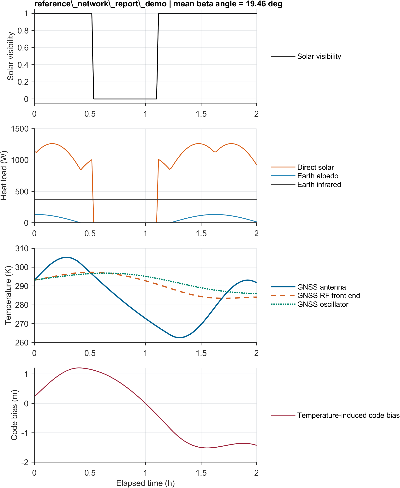
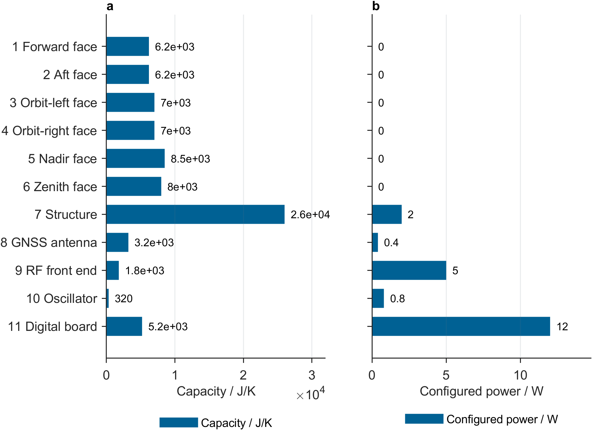
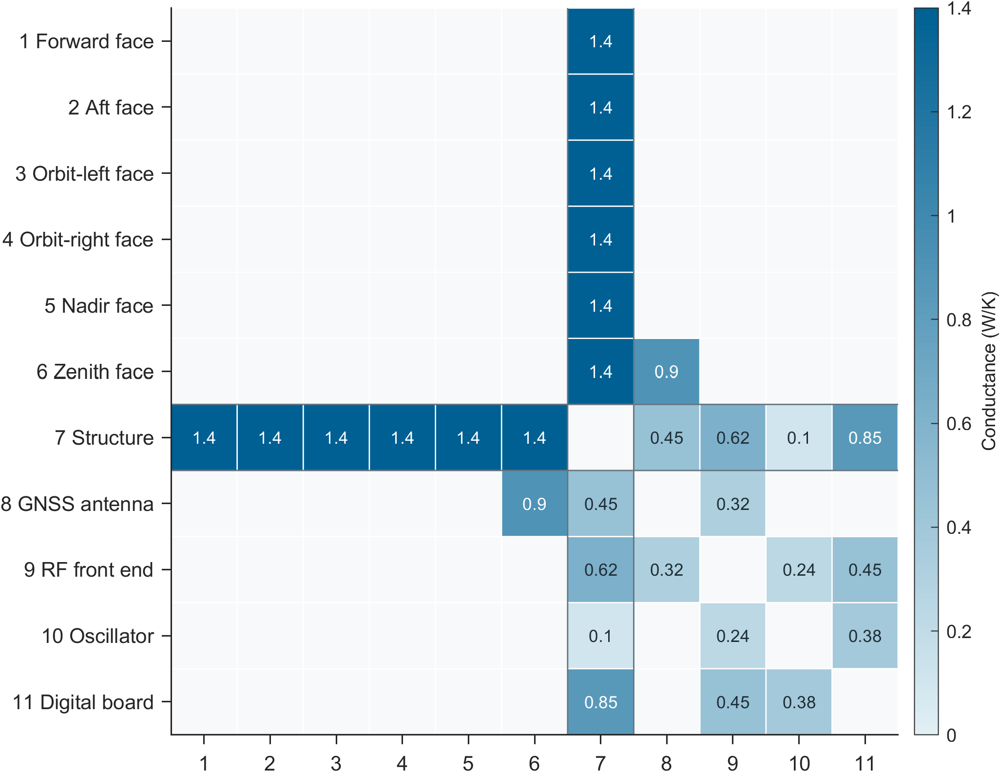
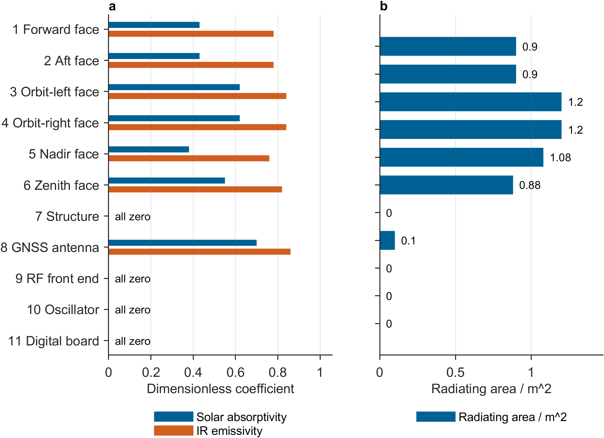
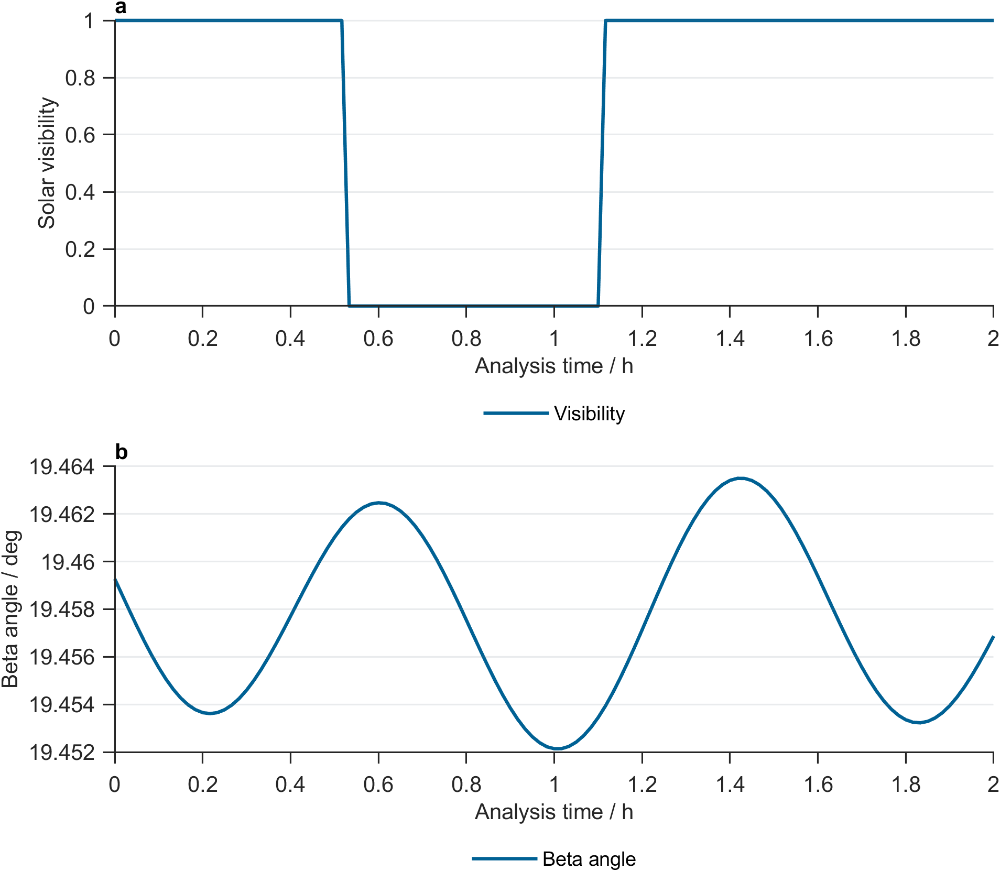
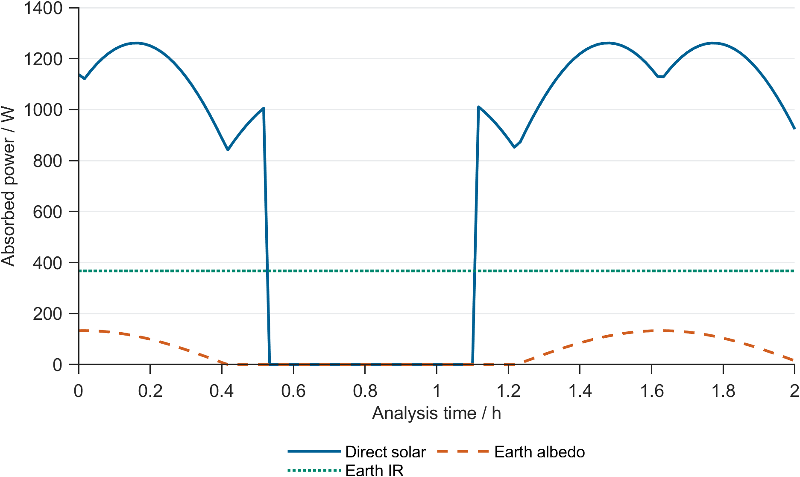
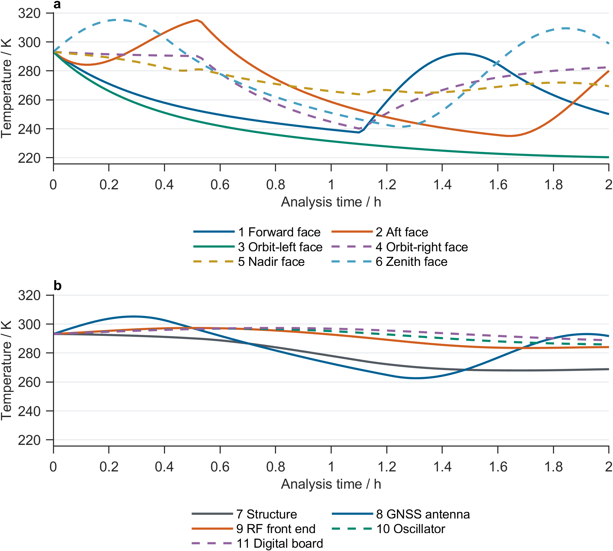
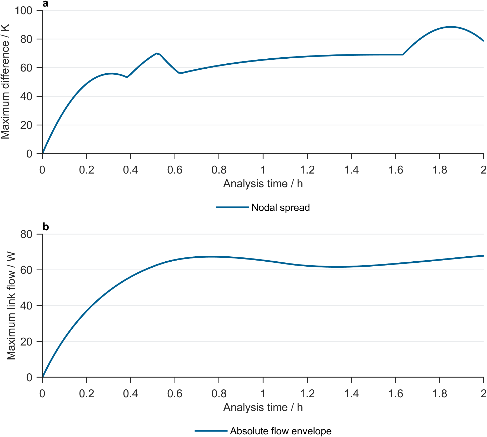
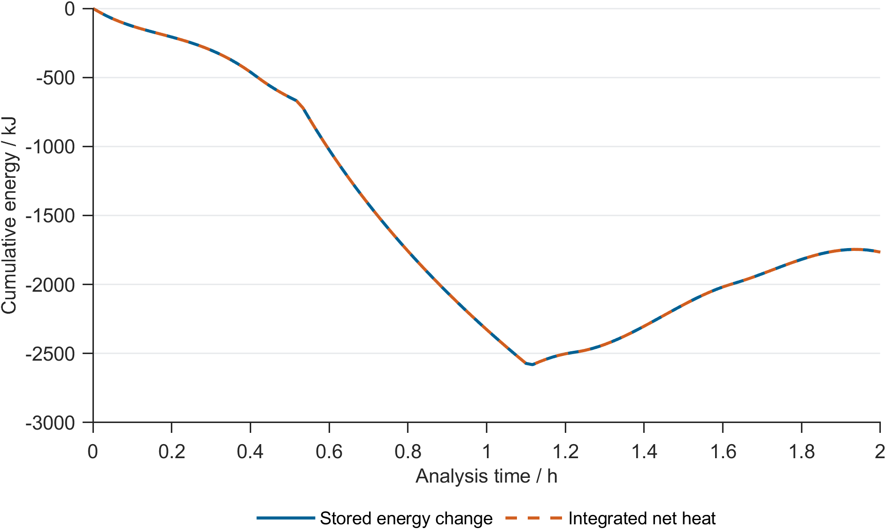
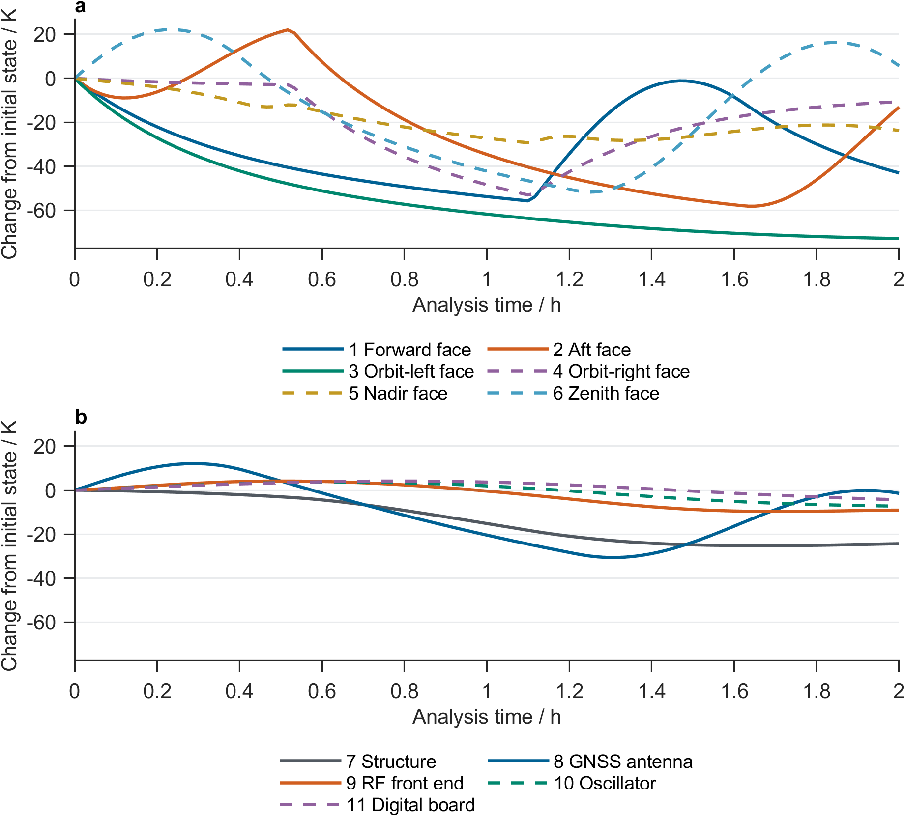

# Thermal simulation results report
Software version: 1.2.9; generated UTC: 2026-10-11T03:24:28Z
## Orbit heating and nodal response
- Mean beta angle: 19.46 deg; eclipse fraction: 28.93%.
- RF temperature span: 13.69 K; assumed temperature-induced code-bias span: 2.685 m.
- Peak delay 2201.2 s (1 eligible cycle).
- 2 illumination transitions occurred over this run.
- No warmup was used; initial-temperature transients may affect spans and lag.

## Thermal capacity and internal power
- 11 nodes; total capacity 79420 J/K; configured internal power 20.2 W.
- Spacecraft structure has the largest capacity: 26000 J/K (32.7% of total).
- Receiver digital board has the highest configured power: 12 W.
- 11/11 nodes plotted, selected by full temperature range; all are tabulated.

## Thermal links and conductance
- 15 conductive links; Spacecraft structure has the most connections (10).
- First 11/11 nodes shown; filled cells and values give conductance. Blank cells have no direct conductive link.
- The symmetric matrix shows each reciprocal link twice. Conductances are listed in the link CSV.
- Among links connected to GNSS RF front end, the largest absolute mean net transfer is GNSS RF front end to Spacecraft structure at 7.190 W. Total mean net conduction from the response node is 7.260 W (positive outward). This identifies an active path using heat flow rather than link count.

## Optical properties and radiating area
- Total external radiating area: 6.26 m^2. Zero values are explicitly labelled.
- 11/11 nodes plotted, selected by full temperature range; all are tabulated.
- Spacecraft structure, GNSS RF front end, GNSS oscillator, Receiver digital board have zero projected and external radiating areas and exchange heat through conductive links.

## Illumination and eclipse structure
- Trapezoidal time weighting estimates partial/full eclipse over 29.17% of the window.
- Solar visibility ranges from 0.000 to 1.000; orbital period 96.69 min.
- Eclipse uses visibility below 0.999. Time-weighted and epoch-count fractions can differ.
- 1 eclipse entries and 1 exits; beta angle 19.452 to 19.463 deg.

## Environmental heat inputs
- Time-mean absorbed power: solar 795.415 W; albedo 51.963 W; Earth IR 367.422 W.
- Curves sum absorbed power over the network, including area and absorption properties.
- Solar absorbed power 0.000 to 1261.402 W; Earth IR 367.422 to 367.422 W.
- Time-integrated external heat shares are 65.5% direct solar, 4.3% albedo and 30.2% Earth infrared. direct solar contributes most to external absorption; these are heat-input shares, not temperature-response attribution.

## Nodal temperatures and extrema
- Window maximum 315.304 K (42.15 deg C, node 6); minimum 220.361 K (-52.79 deg C, node 3).
- Largest full peak-to-peak range 80.070 K (node 2), distinct from a 95th-5th percentile span.
- Hottest node: Zenith face; coldest node: Orbit-left face.
- 11/11 nodes plotted, selected by full temperature range; all are tabulated.
- Peak delay 2201.2 s (1 eligible cycle).
- Temperature level and variation describe different demands: the maximum is at Zenith face (315.30 K), the minimum at Orbit-left face (220.36 K), and the largest full range at Aft face (80.07 K).
- GNSS RF front end has a full range of 13.805 K, 17.2% of the largest nodal range. Assess response-node stability directly rather than substituting exterior or network-wide extremes.

## Temperature differences and link heat flow
- Maximum simultaneous nodal spread 88.414 K; maximum absolute single-link flow 67.888 W.
- Panels show epoch-wise temperature spread and the largest absolute link heat flow.
- The envelope takes the largest value across 15 conductive links at each epoch.

## Stored energy and energy balance
- After rebasing both at the analysis start, maximum cumulative closure is 6.0536e-09 J.
- Stored energy is the sum of capacity times temperature change, relative to analysis start.
- Balance: stored energy = external heat + internal heat - radiation + boundary heat.
- End-of-window stored-energy change: -1765.6 kJ.

## Initial state and temperature drift
- Fixed warmup: 0 orbits. Periodic-state convergence was not tested.
- Largest absolute end-minus-start temperature change 72.789 K.
- Endpoints are 1.241 orbits apart; curves are relative to analysis-start temperatures.
- 11/11 nodes plotted, selected by full temperature range; all are tabulated.

## Inputs, mesh, material, orbit and attitude
- Trajectory coordinate system: Geocentric equatorial axes (built-in approximate orbit model)
- Telemetry comparison: Not run (no telemetry data imported for this task)
| Section | Field | Value | Unit | Status | Source | Notes |
|---|---|---|---|---|---|---|
| task_input | scenario_name | reference_network_report_demo |  | available | scenario.name |  |
| task_input | duration | 7200 | s | available | scenario.durationS |  |
| task_input | time_step | 60 | s | available | scenario.timeStepS |  |
| task_input | warmup_orbits | 0 | orbit | available | scenario.warmupOrbits |  |
| network | node_count | 11 | node | available | network.nodeNames |  |
| network | node_names | face_+X_forward, face_-X_aft, face_+Y_orbit_left, face_-Y_orbit_right, face_+Z_nadir, face_-Z_zenith, spacecraft_structure, gnss_antenna, gnss_rf_frontend, gnss_oscillator, receiver_digital |  | available | network.nodeNames |  |
| network | conductance_range | [0, 1.4] | W/K | available | network.conductanceWK |  |
| network | internal_power_range | [0, 12] | W | available | network.internalPowerW |  |
| orbit_attitude | epoch_start_utc | 2024-03-20 12:00:00 |  | available | scenario.startEpoch |  |
| orbit_attitude | altitude | 600000 | m | available | scenario.orbit.altitudeM |  |
| orbit_attitude | inclination | 97.6 | deg | available | scenario.orbit.inclinationDeg |  |
| orbit_attitude | attitude_mode | nadir |  | available | scenario.attitude.mode |  |
| orbit_attitude | trajectory_frame | approximate_geocentric_equatorial |  | available | result.orbit.frame.name | Approximate equatorial axes shared by the circular orbit and solarVectorECI; no precision precession/nutation transformation. |
| telemetry_comparison | telemetry_status | not_run_no_data |  | available |  | No telemetry result was supplied; validation was not performed. |
## Energy conservation
| Component | Quantity | Value | Unit | Status |
|---|---|---:|---|---|
| scenario | integratedExternalHeatJ | 8746565.15451 | J | available |
| scenario | integratedInternalHeatJ | 145440 | J | available |
| scenario | integratedRadiatedHeatJ | 10657621.1445 | J | available |
| scenario | integratedBoundaryHeatJ | 0 | J | available |
| scenario | integratedNetHeatJ | -1765615.98999 | J | available |
| scenario | maximumEnergyClosureJ | 2.0008883439e-09 | J | available |
## Numerical diagnostics
- `scenario.absoluteToleranceK` = 1e-06 (available)
- `scenario.relativeTolerance` = 1e-08 (available)
- `scenario.acceptedSteps` = 120 (available)
- `scenario.rejectedSteps` = 0 (available)
- `scenario.maximumAcceptedErrorRatio` = 0.959316703862 (available)
- `scenario.maximumEnergyClosureJ` = 2.0008883439e-09 (available)
## Telemetry comparison
Telemetry comparison: Not run (no telemetry data imported for this task)
## Sources and interpretation boundary
- `software`: 1.2.9 (available)
- `scenario`: reference_network_report_demo (available)
Missing modules are marked not_available; this report does not infer contact interfaces, materials, or telemetry conclusions. Without telemetry comparison, the output is simulation-only and must not be described as independent validation.
## Task conclusions
1. Prioritize the high-temperature level at Zenith face, low-temperature level at Orbit-left face, and variation at Aft face in design review: extrema 315.30/220.36 K and largest range 80.07 K.
2. Prioritize direct solar in environmental-input review: it supplies 65.5% of absorbed external heat. Interpret temperature response together with the heat-transfer paths and orbital phase.
3. The response component GNSS RF front end spans 283.497 to 297.302 K, with a full range of 13.805 K. Use these component values separately from spacecraft extrema.
4. Prioritize the GNSS RF front end / Spacecraft structure contact in conductance review: mean net transfer is 7.190 W. This ranking uses observed model heat flow, not a conductance-perturbation experiment.
